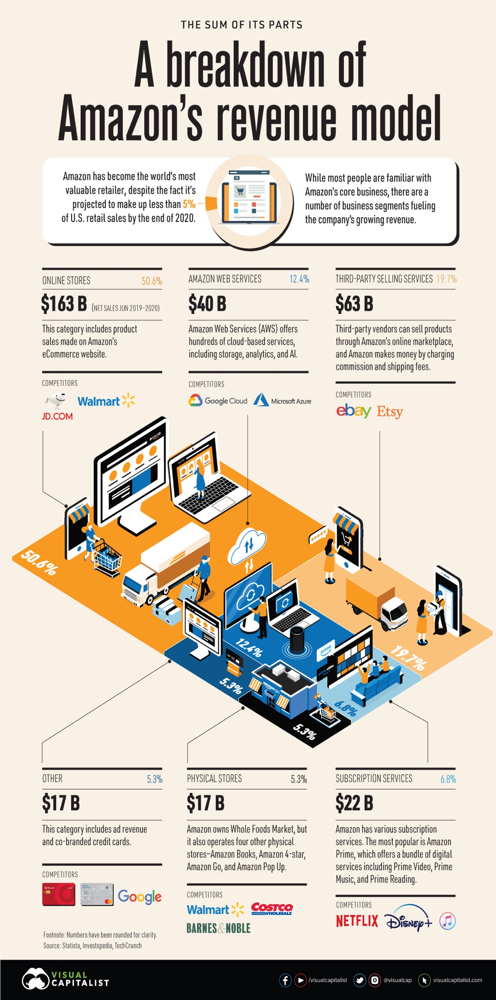
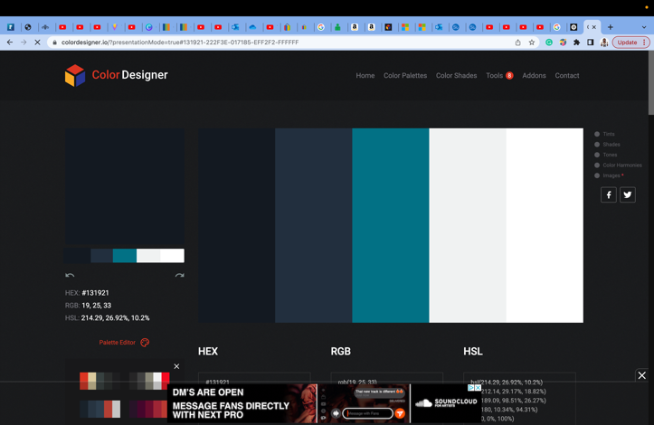
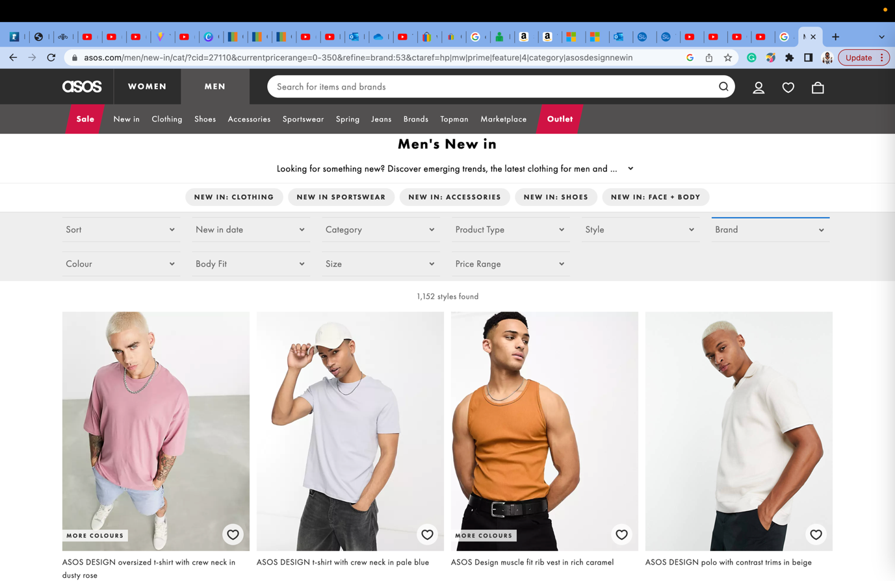
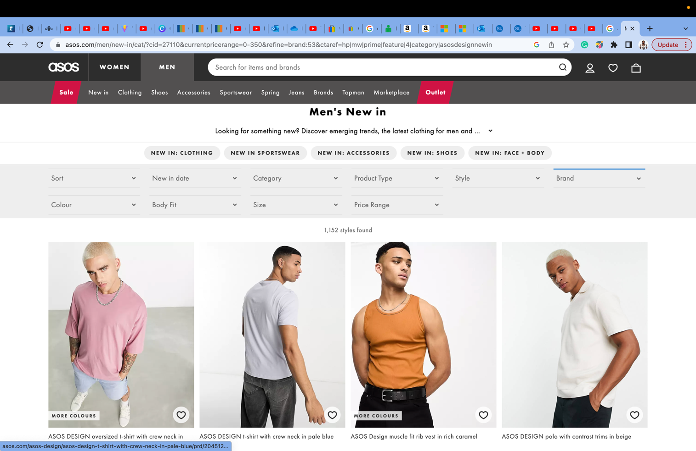
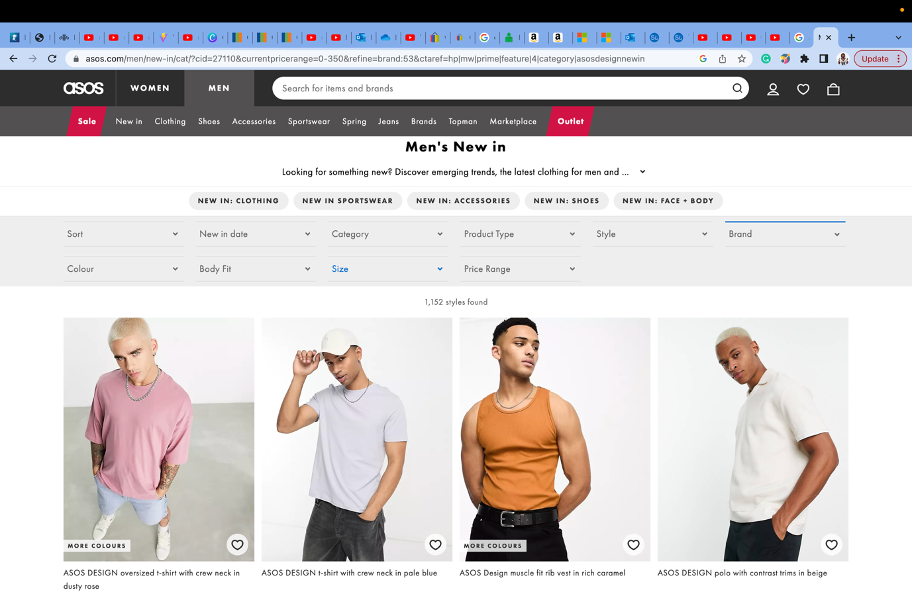
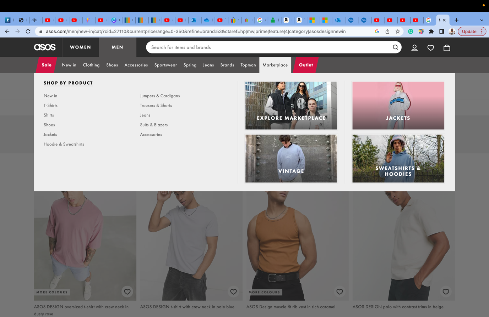
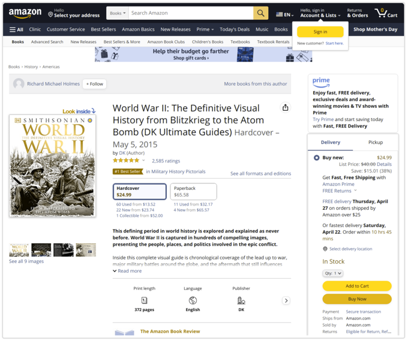
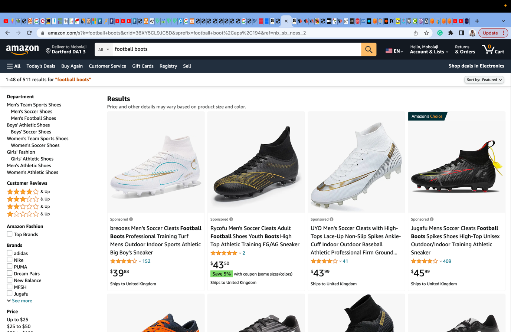
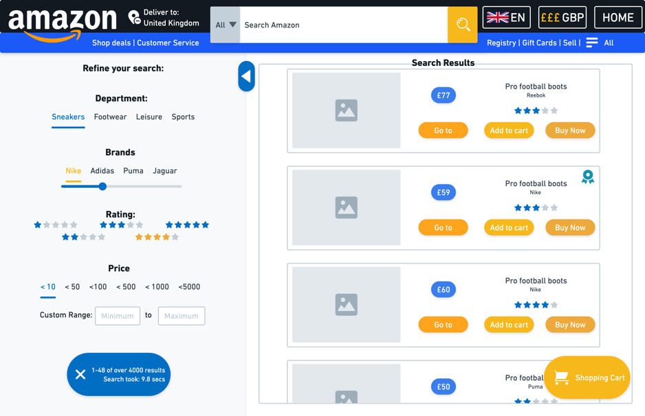
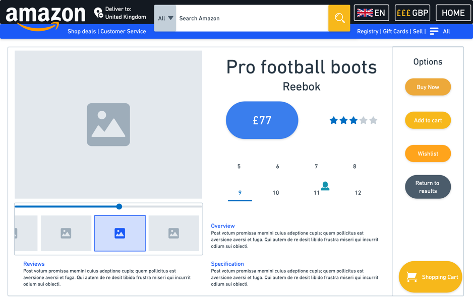

<figure>

</figure>

**Amazon.com: An evaluation of usability and useful function integrations**

## BUSINESS ENVIRONMENT

# Amazon’s Business Model

Jeff Bezos’ Amazon is built on a number of simple principles, including
(Amazon.com, no date):

- Aiming *to be Earth’s most customer-centric company*

- Aiming to *obsess over customers*

- Recognising that *some decisions are consequential and irreversible
  \[…\],* *But most decisions aren’t like that*

The flywheel designed by Bezos encapsulates this (Amazon.com, no date):

An evaluation of Amazon’s e-commerce strategy reveals Amazon.com’s
target areas (Slater, no date): Providing customer value through *lower
prices*; huge selection range and; *customer convenience:* striving to
better the diffusion of innovation curve, evidenced by Bezos himself
(Rogers, 1983; Amazon.com, no date):

- *We want to be a large company that’s also an invention machine*

- *Day 2 is stasis. Followed by irrelevance. Followed by excruciating, painful decline… And that is why it is always Day 1*

Amazon aims to increase the number of innovators and early adopters
while decreasing the laggards. Thus frontier technology is pushed,
changing their e-commerce presentation. To achieve this, their
e-commerce platform encourages a two-way network of buying and selling
between parties; facilitated by in-house technologies (Jewell, 2017;
TipRanks, 2023; SimilarWeb, 2023; Semrush, 2023):

- Cloud53: Their custom configurable DNS

- CloudFront: which reduces latency through data-packet route
  specification

- AWS WAF: offering pingback attack protection via filtering

- AWS Shield: which Protects HTTP layers 3-7 against DDoS attacks

- DynamoDB: Their non-relational database to handle the 2.5 – 3B
  visits/month to Amazon.com

Amazon’s distribution is aimed at continuous improvement, via
innovation; while their financial strategy stems from fast cash flow,
aided by partnerships and brand deals, benefitting Amazon in the
long-term.

Amazon.com’s website is predicated on both SQL and NoSQL databases,
having successfully migrated from Oracle-leased databases to their own:
Aurora, and DynamoDB; reducing annual expenditure (Bar, 2019; TelcoDR,
2022). This accounts for the fast speed of Amazon’s search engine and
information display – increasing usability (Deloitte, no date; Ruihan &
Zong-Mou, 2017).

Furthermore, a feature that is not
covered in later heuristic inspections (discernable via pluralistic
walkthrough or feature inspection) is Amazon.com’s use of Artificial
Intelligence to recommend products (Nielsen, 1994; Virinchi, 2022;
Hardesty, 2022). Products are recommended based on previous searches,
recording user activity during sessions.

## CUSTOMER JOURNIES

# Three Basic Functions

Amazon.com’s
non-negotiable functions: navigation, input handling and output; are
achieved (Zhang, 2023): A user story can illustrate this. **User A –
Alex** is a young football player who wishes to purchase playing boots:

Alex wishes to search, and Amazon.com accommodates this with a function
at the screen’s summit, coupled with a label: *Search Amazon,* and
looking-glass icon, synonymous with computer search (Sherwin, 2014).
Additionally, one can specify the search department: increasing search
speed and narrowing options (Inci, 2020).

In conjunction, user input is not limited to words, allowing criterion
selection, or screen manipulation to select categories from the landing.
The output is near instantaneous, producing a formatted set of results.

# Alex’s User Journey

Alex’s perspective on usability is guided by numerous stylistic
decisions. The aforementioned landing page emphasizes search, while the
product page aims to entice Alex to select certain product choices, for
Amazon’s benefit (Nielsen, 1999). The subtle use of colour to draw
attention towards product promotion evidences this: with *save 5%* and
*Amazon’s Choice* attracting the user’s gaze via colour contrast
(Beaird, 2008).

The display is efficient, with a tabularised, reusable layout for each
item, and a design that meets customer expectations to display: brand,
name and price; although size is omitted (for clothing) – possibly
deliberately: if users knew their item was unavailable, it would reduce
the chance of entertaining alternatives (Cilliers & Meyer, 2023; Davis,
2019).

Amazon’s customer focus informs their use of product images as focal
points on the page, with the price being of secondary concern to entice
buyers to select products that match their aesthetic. Between two pages,
the three essential requirements for a good e-commerce site are met, yet
their minutiae warrants discussion.

The product page (assuming boot selection) is tripartite, with the
product’s information emphasised through having the largest,
centrally-positioned section (Beaird, 2008). This information is split
horizontally with the most valuable information taking precedence: name
🡪 price 🡪 colour 🡪 size, then additional information. This embraces the
concept of continual flow of sight; guiding the user to view the most
important information first and proceed naturally down towards
information that less concerning to Amazon itself (Lupton, 2008).

<figure>

<figcaption>
Figure: The product pre-purchase screen – as seen by
Alex
</figcaption>
</figure>

Breaking this slightly, the price is placed in a position that is
roughly central, in an emboldened font style, attracting attention to
Amazon’s flywheel philosophy of *lower pricing*, which instigates
positive *customer experience (Amazon.com, no date)*.

Differing from this, emphasis via isolation is present with the
purchasing menu, which is separated by a border from the rest of the
screen, to entice purchase (Beaird, 2008). This is furthered by the use
of yellow and orange which stand out distinctly from the white and
darker blue hues of the page, both imploring the user to make a decision
towards purchasing the product.

The subtle use of colour theory is prevalent on this screen, with the
aforementioned yellow and orange hues contrasting the blues of the rest
of the page (Beaird, 2008). While not specifically complementary, the
orange hue’s complements are more luminous **and** saturated shades of
the blues used along the navigation section (the same cannot be said for
the yellow) (Canva.com, no date; Color-calculator.com, 2021):

In concluding Alex’s pre-purchase
journey, all three pages minimally showcase system status via the search
bar, adding a grey overly to the rest of the screen, yet none showcase
the status concerning active screen sections (on mouse hover) barring
the product page’s gallery (Harley, 2018). This could be improved,
changing the hue of the white space in hovered areas subtly to
accommodate the customer-centric model Amazon prides itself upon. In
addition, a subtle-timed colour change effect on the purchase buttons
would immediately attract attention from users, which would entice
purchase (Prisacari & Holme, 2013).

Improvements have been seen in the past, with the lack of a site-wizard
stemming from the same reasoning behind the removal of the tab feature
that Amazon held for the entire early 2000s: over-clustering of
information via proximity made the site more difficult to navigate;
especially while early adopters were its primary users (Beaird, 2008;
Wroblewski, 2005; Nielsen, 2005; Rogers, 1983).

## HEURISTIC EVALUATION

# Use Cases

In order to effectively evaluate
Amazon.com in more depth, simple heuristic evaluations can be deployed.
For this, two new user scenarios will be introduced. **User B – Ben**
and **User C – Christina**, holding differing goals:

<figure>

<figcaption>Figure 11: Dataflow diagram of the two use cases
 </figcaption>
</figure>

# Evaluations

Three different heuristics have been
employed to ensure a variety of design areas are scrutinised. The first
inspects a set of achievable rules (Shneiderman et al., 2018):

Amazon.com is excellent at reducing the need for information recall,
with their simple UI allowing the user to simply browse products as-if
they were *window-shopping* in real-life, while the speed of load of the
page additionally contributes to a sense of easy-use, and reduces the
likelihood of site abandonment (Tuch et al., 2012; Deloitte, no date;
Lindgaard et al., 2006). As well as this, the storefront has a
consistent layout and use of a simple colour palette (Color-Picker.com,
2022; Colordesigner.io, no date).

It is clear from this *subjective* evaluation that the main issues
stemming from Amazon.com are its lack of user feedback and user action
strictness. Amazon.com could take inspiration from Asos.com: which
utilises three methods of feedback: Upon hovering over a product, a
different angle is displayed, showcasing mouse position; within the
navigation system, active sections produce sub-menus via an overlay on
the screen and; when searching for a product, filters are highlighted
blue when hovered over, to ensure the user is aware of their current
location (ASOS.com, no date).

\

The second heuristic (page below)
interrogates Amazon.com based on its user experience (Tognazzini, 2014).
Through this, an instance of achieved accessibility is discerned, as the
site does seem to accommodate for the colour-blind population –
comprising 1 in 12 men according to the NEI (Venngage.com, no date;
National Eye Institute, 2019).

The above heuristic is rigorous in exposing areas for improvement.
Again: autonomy, colour and consistency are implemented successfully,
alongside readability and learnability; however, Christina was limited
in options if a payment mistake occurred, while critical functions were
not always visible to both users.

The latter issue poses a larger problem - as international users and
people that tend to scroll on webpages would both struggle with Amazon:
the visible currency change option is located in the footer and; the
navigation system does not follow the user down the page. These are
simple to change: display the currency more obviously in navigation to
ensure correct utilisation, and force the navigation bar scroll.

> The navigation bar at the top is glued to the screen at load (top),
even if one scrolls halfway down (bottom)

> Apple.com utilises this sticky navigation bar to great effect (Anthony,
2022; Apple.com, no date):

A subtle feature that Amazon utilises, is the application of Fitt’s law
(Budiu, 2022). The icons and selected objects on Amazon’s site are easy
to hover over and hard to misclick, which demonstrates a good
application of the within UI/UX.

While the usability of Amazon.com is clearly the driving force behind
its design, the lack of obvious ratios in page sectioning is apparent,
and its inclusion could benefit user experience. The golden ratio evokes
a positive response from users when utilised to distribute webpage
sections and could be employed on the search results screen (Beaird,
2008). Additionally, the filter section (which in theory, would now
occupy near to a third of the screen’s width) could benefit from the
addition of icons, to better partition the clustered text that may prove
difficult for some to read (Nair, 2021).

<figure>

<figcaption>
 Division of page according to the Golden Ratio
Rule
</figcaption>
</figure>

The difficulty imposed by the filter section shows a lack of accoutance
for accessibility within Amazon’s design (CDC.com, 2018). Without
signing in – one cannot access the accessibility menu, and this creates
a paradox: accessibility cannot be accessed without logging in, which
may be impossible for a particular user without changing said settings.
Take, for instance, **User D – Demetri**, who has poor eyesight and
utilises text-to-speech. In the absence of a text-to-speech function,
Demetri is left unable to locate the login window and thus unable to
progress through the website.

<figure>

</figure>

This predicament requires one of two possible solutions: enforcing a
login upon entry, or ensuring that accessibility settings are clear,
obvious and changeable from the landing page of the website (Pinedo,
2020).

The flaws in Amazon.com’s site
revealed by the previous heuristics are exacerbated by the third, which
elucidates the same issues (Nielsen, 1994):

Nielsen’s usability heuristics showcases a lack of feedback to the user
throughout the process of purchasing a product, which does not reflect
the real-world.

Utilising elements of the usability heuristics mentioned above, a new
model could be proposed for Amazon.com:

<figure></figure>
</figure>

Note the ease of use one has in accessing: location, language and
currency if a search requires a change. Additionally, the colour scheme
has been selected with brighter blue hues that are more harmonious with
the vibrant yellows/oranges.

<figure>

</figure>

The
Golden ratio has been applied to the split of the screens contents, to
avoid an over-clustering of products, and this informs the list
structure as well.

On the product page, more emphasis is placed on the price, and purchase
options than any other item of information. In addition, the *return to
results* button is present – but given a dull hue to detract from its
presence.

## CONCLUSION

**Use Cases**

In summation, Amazon.com excels in the design of its website for its
purpose – to entice the customer to conduct fast-paced purchase of
products, and offer alternatives should they not find their desired
product. However, Amazon.com has a number of limitations, namely: their
lack of easy accessibility settings access; their lack of error
diagnostics for the user’s benefit and; an overall lack of state
feedback to allow the user to understand their position on the page.

These drawbacks do not damage Amazon’s reputation or business
performance, but may hold a monetary cost as it increases the amount of
time it takes for customers to make their transactions and could
potentially deter impatient customers altogether (Brutlag, 2009).

## BIBLIOGRAPHY

- “Hex Color Picker” (2022) *Color Picker*. Available at:
  https://color-picker.dllplayer.com/ (Accessed: April 21, 2023).

- (no date) *Apple*. Available at: https://www.apple.com/ (Accessed:
  April 22, 2023).

- *About Amazon* (no date) *amazon.jobs*. Available at:
  https://www.amazon.jobs/en-gb/landing_pages/about-amazon#:~:text=Amazon's%20mission%20is%20%22to%20be,the%20heart%20of%20that%20mission.
  (Accessed: April 20, 2023).

- *Amazon.com market share, revenue and Traffic Analytics -
  Similarweb* (2023) *SimilarWeb*. Available at:
  https://www.similarweb.com/website/amazon.com/ (Accessed: April 20,
  2023).

- *Amazon.com website Traffic Report, Growth & Stats* (2023) *TipRanks*.
  Available at: https://www.tipranks.com/stocks/amzn/website-traffic
  (Accessed: April 20, 2023).

- *Amazon.com website traffic, ranking, analytics \[March 2023\]* (2023)
  *Semrush*. Available at:
  https://www.semrush.com/website/amazon.com/overview/ (Accessed: April
  20, 2023).

- Anthony (2022) *When you should use a sticky navigation bar*, *UX
  Movement*. Available at:
  https://uxmovement.com/navigation/when-you-should-use-a-sticky-navigation-bar/
  (Accessed: April 22, 2023).

- Bar, J. (2019) *Migration Complete – Amazon’s Consumer Business Just
  Turned off its Final Oracle Database*, *Amazon*. Available at:
  https://aws.amazon.com/blogs/aws/migration-complete-amazons-consumer-business-just-turned-off-its-final-oracle-database/
  (Accessed: April 20, 2023).

- Beaird, J. (2008) *The principles of beautiful web design*,
  *SitePoint*. SitePoint. Available at:
  https://www.sitepoint.com/principles-beautiful-web-design/ (Accessed:
  April 24, 2023).

- Brutlag, J. (2009) *Speed matters for google web search*. Available
  at: https://services.google.com/fh/files/blogs/google_delayexp.pdf
  (Accessed: April 24, 2023).

- Budiu, R. (2022) *Fitts’s law and its applications in UX*, *Nielsen
  Norman Group*. Available at:
  https://www.nngroup.com/articles/fitts-law/ (Accessed: May 2023).

- *CDC: 1 in 4 US adults live with a disability* (2018) *Centers for
  Disease Control and Prevention*. Centers for Disease Control and
  Prevention. Available at:
  https://www.cdc.gov/media/releases/2018/p0816-disability.html
  (Accessed: April 22, 2023).

- Cilliers, J. and Meyer, M. (2023) *Should you hide your out of stock
  products?*, *Egnition*. Egnition. Available at:
  https://egnition.io/a/answers/out-of-stock/should-you-hide-your-out-of-stock-products
  (Accessed: April 24, 2023).

- *Color blindness* (2019) *National Eye Institute*. U.S. Department of
  Health and Human Services. Available at:
  https://www.nei.nih.gov/learn-about-eye-health/eye-conditions-and-diseases/color-blindness
  (Accessed: April 22, 2023).

- *Color designer - simple color palette generator* (no date) *Color
  Designer - Simple Color Palette Generator*. Available at:
  https://colordesigner.io/?presentationMode=true#131921-222F3E-017185-EFF2F2-FFFFFF
  (Accessed: April 22, 2023).

- *Color wheel - color calculator* (2021) *Color Calculator*. Available
  at: https://www.sessions.edu/color-calculator/ (Accessed: April 21,
  2023).

- *Color wheel - color theory and calculator \| canva colors* (no date)
  *Color Wheel*. Available at: https://www.canva.com/colors/color-wheel/
  (Accessed: April 21, 2023).

- Davis, K.M. (2019) *5 content marketing stats that will help you reach
  your audience*, *Forbes*. Forbes Magazine. Available at:
  https://www.forbes.com/sites/forbescontentmarketing/2019/03/01/5-content-marketing-stats-that-will-help-you-reach-your-audience/?sh=5c51efa86d8b
  (Accessed: April 22, 2023).

- *Free color blind simulator: Visual impairment checker* (no date)
  *Venngage*. Available at:
  https://venngage.com/tools/color-blind-simulator (Accessed: April 22,
  2023).

- Gualtieri, M. (2009) *Leaving user experience to chance hurts
  companies*, *Forrester*. Available at:
  https://www.forrester.com/blogs/09-10-15-leaving_user_experience_to_chance_hurts_companies/
  (Accessed: April 22, 2023).

- Hardesty, L. (2022) *The history of Amazon's recommendation
  algorithm*, *Amazon Science*. Amazon Science. Available at:
  https://www.amazon.science/the-history-of-amazons-recommendation-algorithm
  (Accessed: April 20, 2023).

- Harley, A. (2018) *Visibility of system status*, *Nielsen Norman
  Group*. Available at:
  https://www.nngroup.com/articles/visibility-system-status/ (Accessed:
  April 24, 2023).

- Inci, D. (2020) *Council Post: E-Commerce Search and filter: The
  functionality that can make millions*, *Forbes*. Forbes Magazine.
  Available at:
  https://www.forbes.com/sites/theyec/2020/03/20/e-commerce-search-and-filter-the-functionality-that-can-make-millions/?sh=108346c61703
  (Accessed: April 24, 2023).

- Jewell, G. (2017) *Case study: The internals of Amazon.com's
  architecture that allows it to securely scale for millions of
  transactions per second with low latency, and high availability -
  CTD305 - re:invent 2017*, *SlideShare*. Available at:
  https://www.slideshare.net/AmazonWebServices/case-study-the-internals-of-amazoncoms-architecture-that-allows-it-to-securely-scale-for-millions-of-transactions-per-second-with-low-latency-and-high-availability-ctd305-reinvent-2017
  (Accessed: April 20, 2023).

- *Keep talkin' Larry: How Amazon weaned itself off Oracle
  databases* (2022) *TelcoDR*. Available at:
  https://www.telcodr.com/keep-talkin-larry-how-amazon-weaned-itself-off-oracle-databases/
  (Accessed: April 23, 2023).

- Lindgaard, G. *et al.* (2006) ‘Attention web designers: You have 50
  milliseconds to make a good first impression!’, *Behaviour &
  Information Technology*. Taylor & Francis, 25(2), pp. 115–126. doi:
  10.1080/01449290500330448. (Accessed: April 22, 2023)

- Lupton, E. (2008). *“Hierarchy” in Graphic Design: The New Basics.*
  New York: Princeton Architectural Press. pp 114-123

- *Milliseconds make millions - deloitte.com* (no date) *Deloitte*.
  Available at:
  https://www2.deloitte.com/content/dam/Deloitte/ie/Documents/Consulting/Milliseconds_Make_Millions_report.pdf?tap_cid=02a297e0-1e3a-11ed-a712-41f1b31ca55d
  (Accessed: April 22, 2023).

- Nair, V. (2021) *Amazon Design Case Study*, *Medium*. Bootcamp.
  Available at:
  https://bootcamp.uxdesign.cc/amazon-a-design-case-study-e507791558bd
  (Accessed: April 22, 2023).

- Nielsen, J. (1994) *Usability inspection methods*. Boston, MA: John
  Wiley & Sons.

- Nielsen, J. (1994). *Enhancing the explanatory power of usability
  heuristics.* Boston, MA, pp. 152-158.

- Nielsen, J. (1999) *Why people shop on the web*, *Nielsen Norman
  Group*. Available at:
  https://www.nngroup.com/articles/why-people-shop-on-the-web/
  (Accessed: April 22, 2023).

- Nielsen, J. (2005) *Amazon: No longer the role model for Ecommerce
  Design*, *Nielsen Norman Group*. Available at:
  https://www.nngroup.com/articles/amazon-no-e-commerce-role-model/
  (Accessed: April 21, 2023).

- Pinedo, D. (2020) *Heuristics meets accessibility: A template for
  equitable design in UX research*, *Medium*. Available at:
  https://uxdesign.cc/heuristics-meets-accessibility-100c33341a9b\]
  (Accessed: April 22, 2023).

- Prisacari, A., Holme, T. (2013). *“Using Eye-Tracking to Test and
  Improve Website Design”. In: Marcus, A. (eds) Design, User Experience,
  and Usability. Design Philosophy, Methods, and Tools.* DUXU 2013.
  Lecture Notes in Computer Science, vol 8012. Springer, Berlin,
  Heidelberg. <https://doi.org/10.1007/978-3-642-39229-0_42> (Accessed:
  April 21, 2023)

- Rogers, E.M. (1983) “Innovativeness and Adopter Categories,” in
  *Difussion of innovations*. New York, NY: Free Press, pp. 248–251.

- Ruihan , W. and Zong-Mou , Y. (2017) *SQL vs NoSQL: A Performance
  Comparison.* dissertation.

- Sherwin, K. (2014) *The magnifying-glass icon in search design: Pros
  and cons*, *Nielsen Norman Group*. Available at:
  https://www.nngroup.com/articles/magnifying-glass-icon/ (Accessed:
  April 21, 2023).

- Shneiderman, B. *et al.* (2018) “Theories,” in *Designing the user
  interface: Strategies for effective human-computer interaction*. 6th
  edn. Boston: Pearson, pp. 105–123.

- *Shop men's clothes: Latest Trends & Online Fashion* (no date) *ASOS*.
  Available at: https://www.asos.com/us/men/ (Accessed: April 21, 2023).

- Slater, D. (1999) *Executive insights*, *Amazon*. Available at:
  https://aws.amazon.com/executive-insights/content/how-amazon-defines-and-operationalizes-a-day-1-culture/#:~:text=We%20strive%20to%20deeply%20understand,meaningful%20solutions%20in%20their%20lives.
  (Accessed: April 20, 2023).

- Tognazzini, B. (2014) *First Principles of Interaction Design (revised
  & expanded)*, *askTog*. Available at:
  https://asktog.com/atc/principles-of-interaction-design/ (Accessed:
  April 22, 2023).

- *Tuch, A.N. et Al.* (2012) The role of visual complexity and
  prototypicality regarding first impression of websites: Working
  towards understanding aesthetic judgments. *International Journal of
  Human-Computer Studies, 70(11)*, p.794-811.

- Virinchi, S. (2022) *Using graph neural networks to recommend related
  products*, *Amazon Science*. Amazon Science. Available at:
  https://www.amazon.science/blog/using-graph-neural-networks-to-recommend-related-products
  (Accessed: April 23, 2023).

- Wroblewski, L. (2005) *The history of Amazon's Tab Navigation*,
  *LukeW*. Available at: https://www.lukew.com/ff/entry.asp?178
  (Accessed: April 21, 2023).

- Zhang, G. (2023) “Interface Design (Usability),” *Information System
  Design & Development (BUSI4493 UNUK) (SPR1 22-23)*. Nottingham:
  University of Nottingham.
