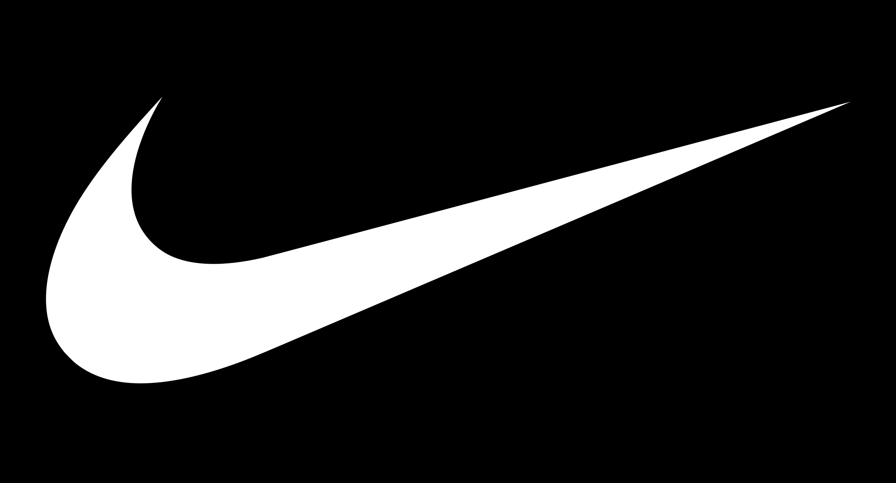
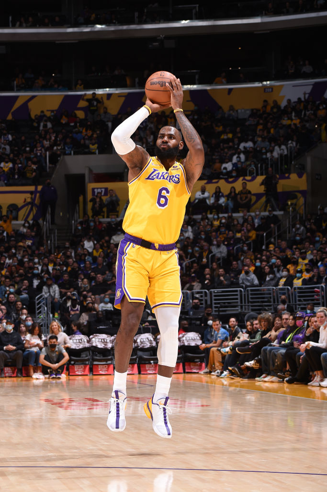
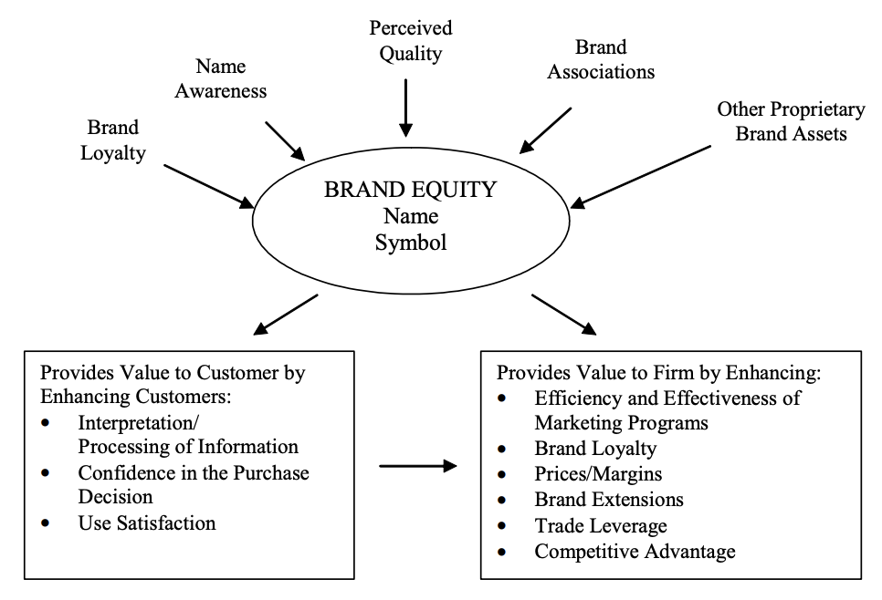
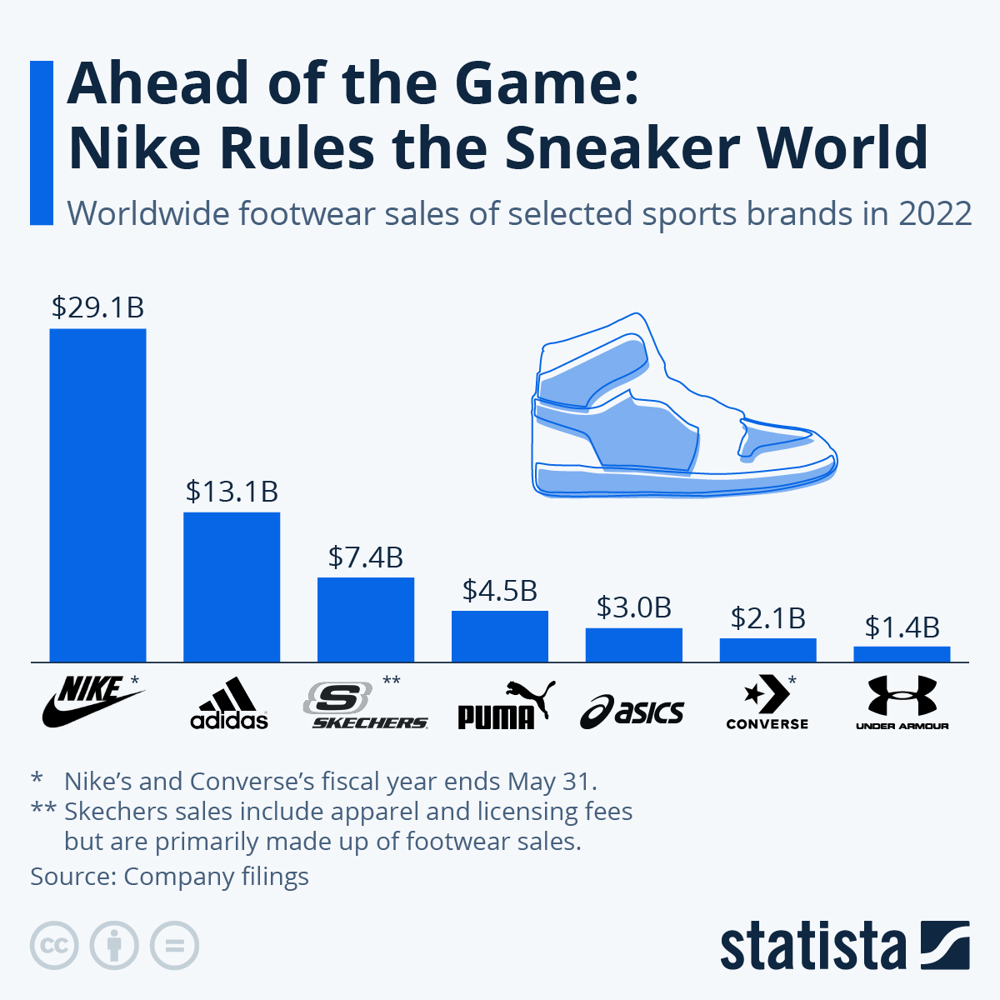
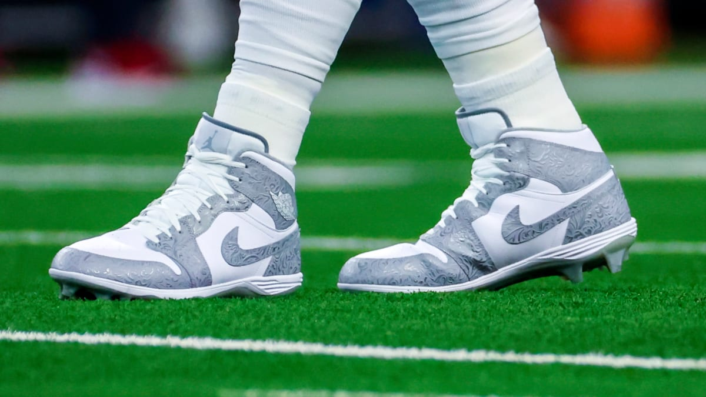
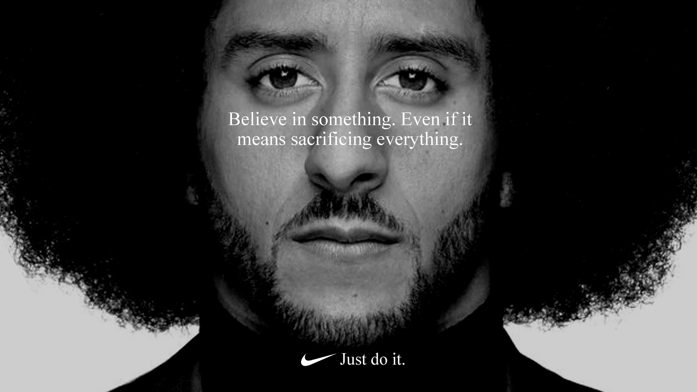
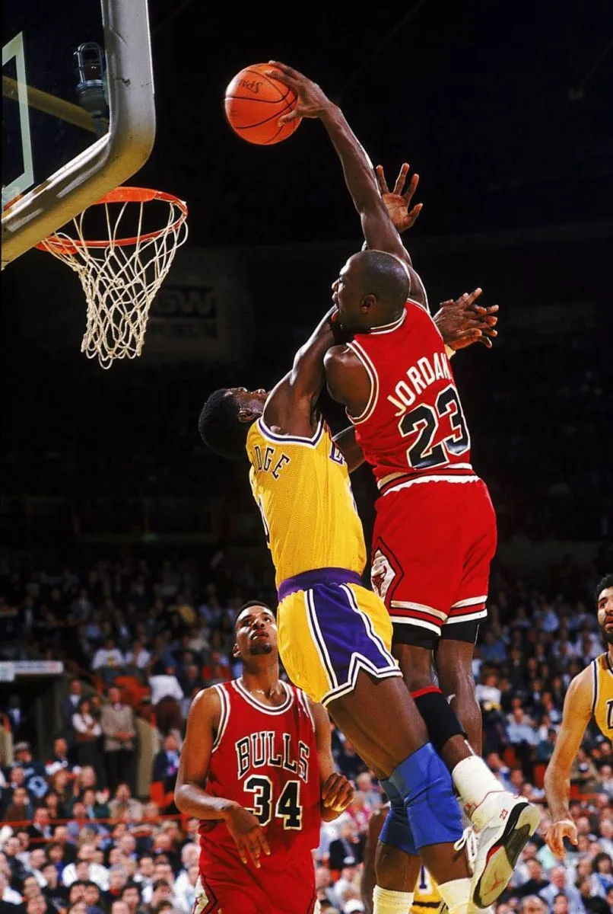
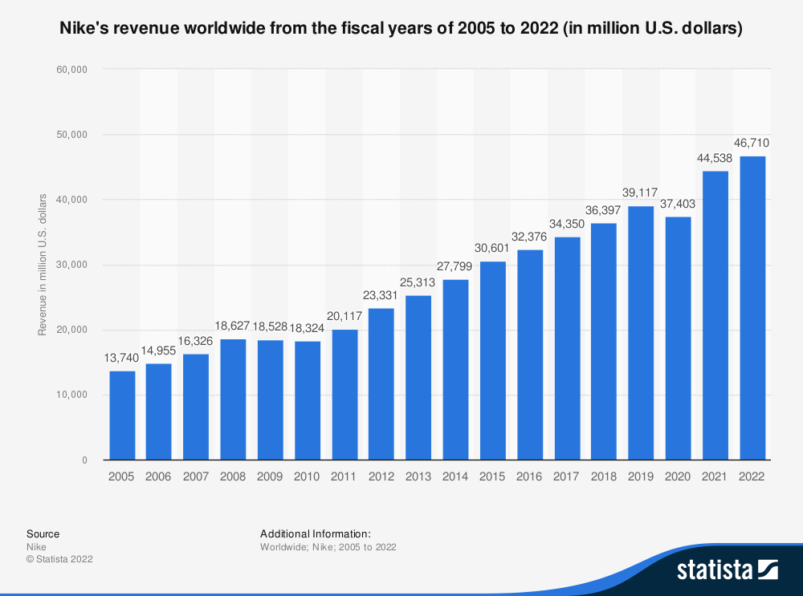
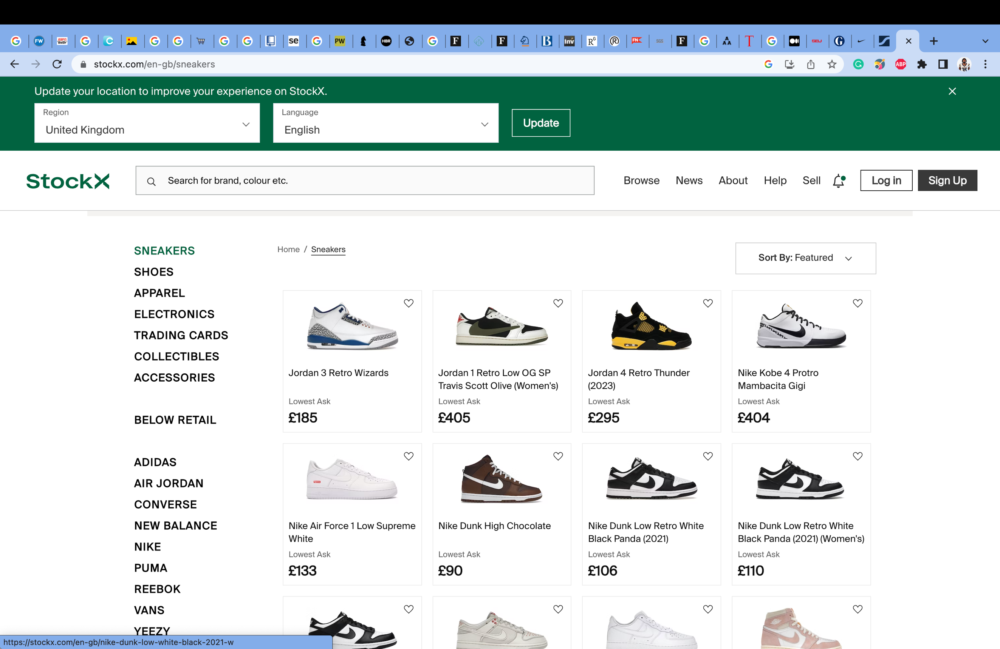
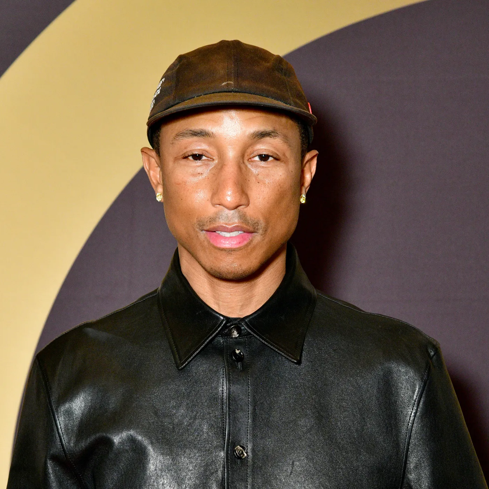

<figure>

</figure>

**JUST DO IT**

An investigation on Nike’s branding and its effect on the customer
journey

# 1.0 SUMMARY

> *What do Lebron James, a 14-year old
> Swanley resident and professional Cameroonian footballer have in
> common?*

This reports aims to dissect Nike Inc’s world-renown branding model,
evaluating its successful e-business migration via two business lenses:
the brand equity model and; the customer decision journey. After their
definitions, their amalgamation will showcase their synergy – and Nike’s
relationship with the wider world.

# 2.0 INTRODUCTION

To contextualise this report: according to DataReportal’s global report,
the internet is explored by 64.4% of the world’s population
(Kemp, 2023). The current marketing
environment has thus seen a paradigm-shift from one-way to two-way,
customer-centric communication (Seamedu,
2023):

> *in recent times, \[…\] social media, and digital marketing have taken
> the forefront in marketing communication efforts*

The World Wide Web, Internet of Things and social networking have
allowed unprecedented customer autonomy in the consumer industry – of
which Nike capitalises upon (Huang, 2023b).
Thence, Nike’s business strategy is thus: sports sponsorship and
ambassadorship – to increase their reputability and image
(Willigan, 2014).

Figure 2: Serena Williams
and Michael Johnson competing in Nike-branded attire

In addition to context, psychology-based definitions must be defined
(Keller, 1993):

- Brand identities describe any *name, term, sign, symbol, or design, or
  combination of them which is intended to identify the goods and
  services of one seller*

- The brand is the amalgam of such recognisable identities

- Memory is simply the brain’s information storage

- Recognition is the mental exposure to a stimuli and ability to discern
  it

- Recall is the ability to utilise memory to retrieve stored information

Finally, Nike’s business model can be scrutinised based on its market
position:

<table>
<caption>
Table 1: SWOT
analysis of the Nike brand
</caption>
<colgroup>
<col style="width: 50%" />
<col style="width: 50%" />
</colgroup>
<thead>
<tr>
<th>
<strong>Strengths:</strong>
</th>
<th>
<strong>Weaknesses:</strong>
</th>
</tr>
</thead>
<tbody>
<tr>
<td><ul>
<li>
Brilliant brand building
</li>
<li>
Outsourced production
</li>
<li>
Global outreach
</li>
<li>
Unique in its approach
</li>
</ul></td>
<td><ul>
<li>
Dependent on footwear market
</li>
<li>
Scandals around forced labour
</li>
<li>
Sells primarily through retailers
</li>
<li>
Recently seen as luxury-brand
</li>
</ul></td>
</tr>
<tr>
<td>
<strong>Opportunities:</strong>
</td>
<td>
<strong>Threats:</strong>
</td>
</tr>
<tr>
<td><ul>
<li>
Emerging markets: China and India
</li>
<li>
Product diversification
</li>
<li>
Athleisure trend
</li>
</ul></td>
<td><ul>
<li>
Dependent on global supply chain
</li>
<li>
Image damage due to exploitative pricing
</li>
<li>
Economic crisis
</li>
<li>
Over-diversification without strategy
</li>
</ul></td>
</tr>
</tbody>
</table>

# 3.0 MODELS

The employed models are the brand equity model and the customer decision
journey.

The **brand equity model** evaluates the perceived value of a specific
brand via collective memory (Huang, 2023b).
Equity denotes its ability to be positive or negative, with the latter
proving facilitating slow growth, loss of revenue and financial turmoil.

There are differing interpretations on brand equity, so this report will
proceed with Keller’s interpretation (Keller,
1993). Aaker provides a comprehensive definition of brand equity
with some concepts mirroring Keller’s. Aaker’s interpretation defines
brand identities as (Aaker, 1991):

<figure>

<figcaption>
Figure 3:
Aaker’s brand equity model (Source: Aaker, 1991)
</figcaption>
</figure>

*A set of brand assets and liabilities linked to a brand, its name and
symbol that add or subtract from the value provided to a firm and/or to
that firm’s customer*

Proceeding with Keller’s model: brand awareness comprises both brand
recognition and recall. Alongside this, brand associations are powerful
identifiers that can impact one’s opinion. They comprise:

- Benefits, which can be: experiential – “what its like to use”;
  functional – “how do they serve their purpose” or; symbolic – “what
  social gain is provided”

- Attitudes, which are salient beliefs about the brand in addition to
  critical evaluations of such

Brand association also includes attributes: physical features and uses
of the product – split between: product attributes, the physical makeup
of the brand’s items and; non-product attributes, such as packaging and
pricing.

Finally, secondary associations can be crafted by knowledge of a brand’s
ownership, or via one’s experience seeing brand ambassadors utilising
product.

Majahan dictates numerous benefits of brand equity emphasis
(Majahan et al., 1994):

- *Enhanced performance \[and\] market efficiency*

- *Longevity*

- *Extensibility*

While this is the case, critical thinking can elucidate the model’s
pitfalls. Today’s age of information has created an abstraction between
consumers and brands, increasing the difficulty in crafting customer
connections (Garg, 2021; Llopis, 2014). In
addition, brand equity is unsustainable without dedicated company teams,
requiring resource allocation (i.e. Nike’s marketing department)
(Willigan, 2014). Positive brand equity
generation is an endeavour, especially due to the consumer
attention-span shift (Llopis, 2014):

> *Consumers are no longer brand loyal. They may be loyal to the
> engagement experience that a particular brand offers*

Thus, brand equity is costly, but beneficial. Its final critique is
simply, its classification as a “model”: brand equity has numerous
definitions and is not a unified marketing science; it is instead a
methodology, employed to improve customer-relationship management
(Feldwick, 1996).

<figure>

<figcaption>
Figure 4:
Brand Equity model – based on Keller’s definition (Source: Keller,
1993)
</figcaption>
</figure>

The model can correctly identify weaknesses within a brand’s marketing
strategy, but does not independently scrutinise the customer’s mental
process during purchase (Huang, 2023b). Hence:
McKinsey’s **customer decision journey**, introduced
(Elzinga et al., 2009).

The customer decision journey updates and abstracts the “traditional”
funnel model for decision-making; elucidating a cyclical customer
process - by which customers re-engage with brands when deciding which
to purchase from (Elzinga et al.,
2009).

The benefits of this model are: its ability to map the factors that
affect a customer’s brand decision and where companies can adjust for
their own gain. It must be identified that this model is concerned with
the **customer decision** – not with company-side moves, yet they are
not mutually exclusive. The process seemingly begins once the customer
desires a certain item – which, in modernity, could be spurred by
necessity, or encouraged by media successfully instilling a perceived
benefit of product ownership (Huang, 2023b; Llopis,
2014).

Henceforth – the brand equity model views features that alter public
perception of brand value; whilst the customer decision journey focuses
on consumer’s buying habits, and how such aforementioned perceptions can
inform their purchasing decisions.

Note:the 7 Cs – Context, Content, Community, Customisation,
Communication, Connection and Commerce (Oliver, no
date): can be directly connected to success within the customer’s
active evaluation stage.

Consequently, a full marketing evaluation model is discerned:

<figure>

<figcaption>
Figure 6:
The customer decision process based on perceived brand
equity
</figcaption>
</figure>

Of note is the marketing team’s responsibility for message encoding, via
media, for public consumption, in case message misinterpretation harms
the brand.AN

# 4.0 ANALYSIS

<figure>

<figcaption>Figure 7: Financial
information of the World’s largest sneaker brands (Source: statista,
2023) </figcaption>
</figure>

> Nike currently holds a 38% market share in the athletic clothing industry
(Investing.com, 2023).

As mentioned before, Nike’s strategy consists of excellent sports
ambassadorship alongside well-planned sub-branding to accelerate brand
recognition. For instance: the NFL’s super bowl, boasted 113m viewers in
2023 (Johnson, 2023). Nike endorses (and
designs) the NFL’s kits, increasing recognition
(Liberto, 2020). Nike’s market message
encoding is known for its simplicity and directness: Nike aims to relate
every viewer to a world-renown athlete, through emotional advertising
(Wu, 2022). Within the brand equity model and
during the initial decision stage: Nike has already outclassed its
competition, placing identifiable figures at the forefront of their
marketing campaigns, and allowing passive advertisement through viewers
watching

<figure>

<figcaption>Figure 8: Colin
Kapernick’s advertising campaign for Nike (Source: Abad-Santos, 2018)</figcaption>

<figcaption>Figure 9: Custom
Nike-Jordan brand ‘cleats’ worn by an NFL player (Source: Vinlove, 2022)</figcaption>
</figure>

These methods mirror automotive product-placement within cinema, and is
seemingly as effective (Lewin, 2022).
In-accordance with the consumer-led revolution: viewing athletes perform
in Nike gear strengthens one’s brand recall, while building
trustworthiness that translates into both functional and symbolic
benefit (Keller, 1993). A thought can
illustrate this:

> “If Michael Jordan won Defensive Player of the Year and an NBA
> Championship in Nike-crafted footwear: I can win my college basketball
> game in Nike too.”

<figure>

<figcaption>
Figure 10:
Michael Jordan in his namesake Nike-craft shoe
</figcaption>
</figure>

Whilst a fictitious statement, it elucidates the perceived gain that a
Nike product purchase could make. While these athlete stories attract an
audience to Nike’s brand, they can also deter leisure consumers
(Willigan, 2014). It is evident, that
athleisure clothing holds its fair share of issues
(TechnoGym, no date). Nike is not excluded
from this: their pursuit of a reasonable balance of athletic and apparel
footwear warrants scepticism from extreme fashion consumers and
elite-echelon athletes (TICMall, 2022). Nike
does mitigate this through specification within sub-branding; however,
Nike’s own popularity creates issues: evidenced by the Jordan sub-brand.

Jordan’s, designed for Jordan’s on-court performance, were marketed as
the ultimate basketball footwear, yet, their popularity has since
mythologised them in fashion (Wilbekin, 2023).
This creates difficulty designing future products, which must balance
comfort with performance (Levine, 2022).

To exemplify this: a consumer – fictitiously named Rose – wishes to
purchase basketball shoes for an upcoming game. While she has recalled
and considered Jordan’s in her initial exploration, she has read reviews
on an external brand’s in-game effectiveness and, coupled with her
pre-conceived attitude of Jordan’s being an aesthetic line: she removed
Nike from her active evaluation (Wilbekin, 2023;
Levine, 2022, TICMall, 2022).

Nike’s brand equity is extremely dependent on secondary association. The
adoption of ambassadors and sponsorship could be deemed risk-seeking:
generating high profits from athletic performance yet allowing huge
cash-loss amidst scandal. Evidencing this: the Fifa scandal of 2015 lead
to a noticeable revenue decrease, due to Nike’s ill-placed decision to
“seemingly” endorse corruption (Sports Business
Journal, 2015; McGreal, 2015). Furthermore, disgraced athletes
can damage Nike’s image of perseverance and athletic success through
hard-work, such as with Lance Armstrong’s doping scandal
(Williams, 2012). The largest threat, however,
is undoubtedly the loss of loyal customers – who usually bypass external
exploration due to their familiarity with the Nike product
(Elzinga et al., 2009).

Acknowledging Nike’s brand strategy’s pitfalls, numerous solutions
exist. For the initial decision process, it is recommended that Nike
refrains from sponsorship of entire sporting events. There are too many
unknown factors (from Nike’s intelligence’s viewpoint) that could lead
to reputational disaster (Sports Business Journal,
2015). Additionally, Nike should aim to further promote
**proven**, **trustworthy**, **dependable** athletes that have displayed
engaging stories and excellent resilience in their careers.

In coherence, Nike should either separate their product lines further,
**or** provide analysis on product performance for athletic events.

<figcaption>Figure 11: Josh Jacobs
and Jimmy Butler; two examples of athletes that have faced resilience
(i.e. homelessness) on their path to sporting achievement</figcaption>

> An aside: Nike’s choice of name and logo are deliberately manipulate
> brand awareness (Keller,
> 1993). *Nike*, named for the Greek goddess
> of victory, is both unique and semantically symbolic of their mission
> (Nike.com, no date). The name’s uniqueness
> makes it recognisable amongst product assortments, whilst the swoosh
> logo is iconic and easy to instantly recall. This swoosh deliberately
> adorns Nike’s product packaging, a brand attribute that is expertly
> leveraged for benefit (Keller, 1993). Both
> contribute to an exceptional global brand awareness.

<figure>

<figcaption>Figure 12: Nike’s logo
changes throughout the years</figcaption>
</figure>

Assuming positive brand equity, during the active evaluation phase,
Nike’s e-commerce platform applies the 7-Cs effectively to gain a
competitive edge (Huang, 2023a; Oliver, no
date).

Nike’s website eloquently integrates both aesthetic design and
ergonomics (Nielsen, 1994). The search and
purchase processes are simplistic and accessible; the site avoids
latency and; the structure is well-distributed with its emphasis on
products (Nike.com, no date). Additionally,
Nike’s content holds both breadth and depth, boasting a wide product
range with many personalisation options. (Tighe,
2022).

<figure>

<figcaption>
Figure 13:
Nike’s revenue form the broad product range (Source: Statista,
2022)
</figcaption>
</figure>

<figcaption>Figure 14: Nike’s
e-commerce platform (Source: Nike.com, no date)</figcaption>

Nike ensures accessible customer communication, yet their customer
decision journey is afflicted by a lack of social network for Nike
products. It is notoriously known that most sale of premium Nike
products occurs outside of Nike’s jurisdiction, highlighting an area of
opportunity by to allowing auctioning and direct peer-to-peer sale of product (StockX, no date).

<figure>

<figcaption>
Figure 15:
StockX’s e-commerce platform (Source: StockX, no date)
</figcaption>
</figure>

Despite this, Nike’s e-commerce platform aids in the facilitation of
progression towards customer purchase.

While allowing for positive consumer experience and an increased
likelihood of purchase, Nike’s leisure options seem less adequate than
other brands. Adidas exemplifies a differing secondary association than
Nike’s; utilising artists and musicians to produce distinct shoe-lines,
as opposed to athletes. A recommendation is thus to recruit those within
the entertainment sector, to produce new Nike lines, in addition to the
already established athlete-base.

<figcaption>Figure 16: An assortment
of Pharrell William’s Adidas collaboration: Supercolour Superstars</figcaption>

<figure>

<figcaption>
Figure 17:
Pharrell Williams (Source: thecut.com, 2023)
</figcaption>
</figure>

To improve across both the customer decision journey and Nike’s brand
model, emphasis must be placed on new, neglected user journeys. Nike
could invest in those far removed from sport: providing purely leisure
footwear

or, dedicate themselves entirely to athletic-wear
(Willigan, 2014). In conjunction, Nike should
aim to increase ambassadorship outside of the “western world”: a number
of unique sports are played on the Indian sub-continent, for instance,
which offers a large enough population to impact revenue
(Farooqui, 2022). To illustrate this, an
advertisement campaign within the sport of Kabaddi could hold huge
benefit for Nike and their brand (Farooqui,
2022). Similarly, Nike, understandably, currently holds no
presence in the corporate-world; an area for expansion if marketed
correctly (Sidhu, 2014).

# 5.0 CONCLUSION

Nike’s brand is instantaneously recognisable. This is through the
strategic leveraging of athletes to enforce brand exposure. While this
is highly effective within Nike’s sphere of influence; there are
numerous avenues to better brand development, even in lieu of their
global dominance. Nike’s largest issue is a semantic one: the encoding
of Nike’s media has diffused a clear interpretation of the Nike shoe: is
it solely for leisure or solely for competition?

# 6.0 BIBLIOGRAPHY

- Aaker, David A. (1991). Managing Brand Equity, New York: The Free
  Press

- Abad-Santos, A. (2018) *Nike's Colin Kaepernick ad sparked a boycott -
  and earned \$6 billion for Nike*, *Vox*. Vox. Available at:
  https://www.vox.com/2018/9/24/17895704/nike-colin-kaepernick-boycott-6-billion
  (Accessed: April 25, 2023).

- *Buy and Sell Sneakers* (no date) *StockX*. Available at:
  https://stockx.com/en-gb/sneakers (Accessed: April 26, 2023).

- Elzinga, D. *et al.* (2009) *The consumer decision journey*, *McKinsey
  & Company*. McKinsey & Company. Available at:
  https://www.mckinsey.com/capabilities/growth-marketing-and-sales/our-insights/the-consumer-decision-journey
  (Accessed: April 25, 2023).

- Farooqui, J. (2022) *Season 9: Kabaddi League viewership crosses
  200-million mark*, *The Economic Times*. Available at:
  https://economictimes.indiatimes.com/news/sports/season-9-kabaddi-league-viewership-crosses-200-million-mark/articleshow/96207385.cms?from=mdr
  (Accessed: April 26, 2023).

- Feldwick, P. (1996) “Do we really need ‘brand equity’?,” *Journal of
  Brand Management*, 4(1), pp. 9–28. Available at:
  https://doi.org/10.1057/bm.1996.23.

- *From Athleisure to wellness: How movement and well-being ... -
  technogym* (no date) *TechnoGym*. Available at:
  https://www.technogym.com/gb/newsroom/athleisure-to-wellness-trendy-movement/
  (Accessed: April 25, 2023).

- Garg, N. (2021) *Advantages and disadvantages of brand equity*,
  *TheSERPwire*. Available at:
  https://theserpwire.com/advantages-and-disadvantages-of-brand-equity/#b_disadvantages_of_brand_equity
  (Accessed: April 25, 2023).

- *How does athleisure wear affect your workout performance* (2022) *SGS
  TIC Mall*. Available at:
  https://ticmall.sgs.com/blogs-is-how-does-athleisure-wear-affect-your-workout-performance/
  (Accessed: April 25, 2023).

- Huang, J. (2023a) “Customer Interface,” *E-Business (BUSI4458 UNUK)
  (SPR1 22-23)*. Nottingham: United Kingdom, 20 February.

- Huang, J. (2023b) “Market Communications, Branding & CRM ,”
  *E-Business (BUSI4458 UNUK) (SPR1 22-23)*. Nottingham: United Kingdom,
  27 February.

- Johnson, M. (2023) *NFL TV Ratings*, *Sportsnaut*. Available at:
  https://sportsnaut.com/nfl-tv-ratings-viewership-numbers/ (Accessed:
  April 25, 2023).

- Keller, K.L. (1993) “Conceptualizing, measuring, and managing
  customer-based Brand Equity,” *Journal of Marketing*, 57(1), p. 1.
  Available at: https://doi.org/10.2307/1252054.

- Kemp, S. (2023) *Digital 2023: Global Overview Report - DataReportal –
  Global Digital Insights*, *DataReportal*. DataReportal – Global
  Digital Insights. Available at:
  https://datareportal.com/reports/digital-2023-global-overview-report
  (Accessed: April 25, 2023).

- Levine, A. (2022) *Are Air Jordan 1s good for basketball?*, *All About
  Anthony*. Available at:
  https://www.allaboutanthony.com/air-jordan-1-good-for-basketball/
  (Accessed: April 26, 2023).

- Lewin, A. (2023) *"deep product placement": The implications of the
  Nike-netflix partnership*, *Inside Retail*. Available at:
  https://insideretail.com.au/business/deep-product-placement-the-implications-of-the-nike-netflix-partnership-202301
  (Accessed: April 25, 2023).

- Liberto, D. (2020) *Nike, NFL extend partnership through 2028*,
  *Investopedia*. Investopedia. Available at:
  https://www.investopedia.com/news/nike-nfl-extend-partnership-through-2028/
  (Accessed: April 25, 2023).

- Llopis, G. (2016) *Consumers are no longer brand loyal*, *Forbes*.
  Forbes Magazine. Available at:
  https://www.forbes.com/sites/glennllopis/2014/12/10/consumers-are-no-longer-brand-loyal/?sh=469b10d72ae0
  (Accessed: April 25, 2023).

- Mahajan, Vijay, Vithala, R. Rao, and Srivastava, Rajendra K. (1994).
  An Approach to Assess the Importance of Brand Equity in Acquisition
  Decisions, Journal of Product Innovation Management, 11, 221-235

- McGreal, C. (2015) *Nike dragged into FIFA crisis – but will its brand
  be damaged?*, *The Guardian*. Guardian News and Media. Available at:
  https://www.theguardian.com/football/2015/may/29/nike-fifa-crisis-brand
  (Accessed: April 25, 2023).

- Nielsen, J. (1994). Enhancing the explanatory power of usability
  heuristics. Proc. ACM CHI'94 Conf. (Boston, MA, April 24-28), 152-158.

- *Nike* (no date) *nike.com*. Available at: https://nike.com/gb
  (Accessed: April 26, 2023).

- *Nike dragged into FIFA corruption crisis over deal with Brazilian
  National Team* (2015) *Sports Business Journal*. Sports Business
  Journal. Available at:
  https://www.sportsbusinessjournal.com/Global/Issues/2015/06/01/Marketing-and-Sponsorship/Nike-FIFA-crisis
  (Accessed: April 25, 2023).

- *Nike's Mission* (no date) *About.nike.com*. Available at:
  https://about.nike.com/en (Accessed: April 26, 2023).

- Oliver, D. (no date) *7c’s of Website Design*, *Internet marketing
  reference*. Available at:
  https://blogs.baruch.cuny.edu/cwdoliver/7cs-of-website-design/
  (Accessed: April 25, 2023).

- Richter, F. (2023) *Infographic: Ahead of the game: Nike Rules the
  sneaker world*, *Statista Infographics*. Available at:
  https://www.statista.com/chart/13470/athletic-footwear-sales/#:~:text=Athletic%20Footwear&text=With%20footwear%20sales%20of%20%2429,in%20the%20global%20sneakers%20market.
  (Accessed: April 25, 2023).

- Sidhu, R. (2014) *Clothsurgeon reconstructs Nike Fleece into a
  customized "sweatsuit"*, *Hypebeast*. Hypebeast. Available at:
  https://hypebeast.com/2014/10/clothsurgeon-customizes-sweatsuit-with-nike-tech-pack
  (Accessed: April 26, 2023).

- *The Evolution of Marketing Communications Management* (2023)
  *Seamedu*. Available at:
  https://www.seamedu.com/blog/the-evolution-of-marketing-communications-management#:~:text=The%20evolution%20of%20the%20concept,forefront%20in%20marketing%20communication%20efforts.
  (Accessed: April 25, 2023).

- Tighe, D. (2022) *Nike Annual Revenue Worldwide 2022*, *Statista*.
  Available at:
  https://www.statista.com/statistics/241683/nikes-sales-worldwide-since-2004/
  (Accessed: April 26, 2023).

- *Unleashing the POWER OF DATA: A statistical analysis of Nike's rise
  to the top of the sporting industry* (2023) *Investing.com*. Available
  at: https://www.investing.com/academy/statistics/nike-facts/
  (Accessed: April 25, 2023).

- Vinlove, J. (2022) *Jordan brand supplies NFL players with rare
  cleats*, *Sports Illustrated*. Available at:
  https://www.si.com/fannation/sneakers/news/jordan-brand-supplies-nfl-players-with-rare-cleats
  (Accessed: April 26, 2023).

- Wilbekin, E. (2023) *How the jordan 1 became the sneaker of a
  generation*, *Time*. Time. Available at:
  https://time.com/6269278/jordan-1-sneaker-air-legacy/ (Accessed: April
  26, 2023).

- Williams, M. (2012) *Nike drops deal with Lance Armstrong after he
  'misled us for a decade'*, *The Guardian*. Guardian News and Media.
  Available at:
  https://www.theguardian.com/sport/2012/oct/17/nike-lance-armstrong-misled-decade
  (Accessed: April 26, 2023).

- Willigan, G.E. (2014) *High-performance marketing: An interview with
  Nike's Phil Knight*, *Harvard Business Review*. Available at:
  https://hbr.org/1992/07/high-performance-marketing-an-interview-with-nikes-phil-knight
  (Accessed: April 25, 2023).

- Wu, G. (2022) “The brand analysis of Nike based on its emotional
  branding and marketing strategies,” *BCP Business & Management*, 19,
  pp. 278–284. Available at: https://doi.org/10.54691/bcpbm.v19i.816.

<!-- -->
