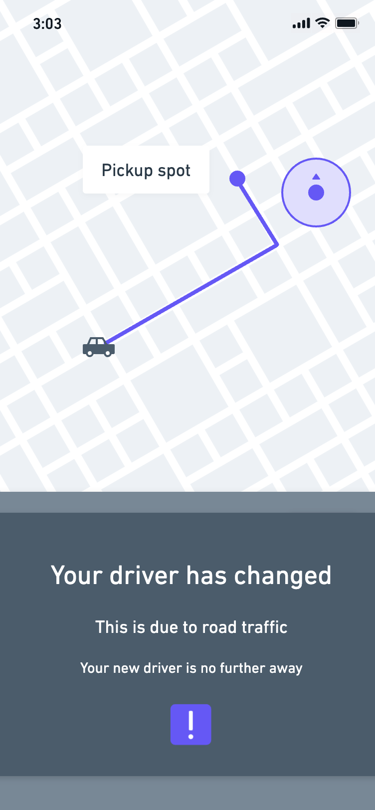
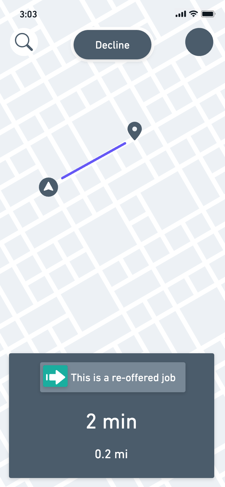
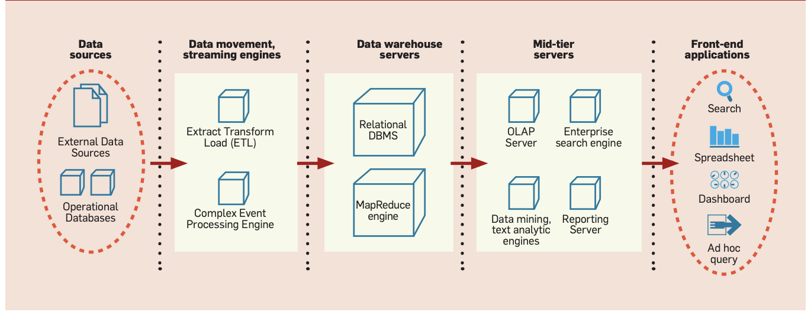
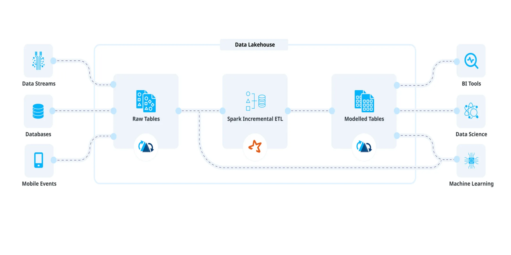

**Uber**

How can Uber apply Machine Learning to improve their Customer
Experience?

## 1. An improved quantitative pickup quality metric for uber

# 1.1 Signals

To develop an accurate pickup quality metric, each feature’s type must
be conveyed:

<table style="width:99%;">
<caption>
Table 1:
Signal breakdown
</caption>
<colgroup>
<col style="width: 19%" />
<col style="width: 80%" />
</colgroup>
<thead>
<tr>
<th>
Type of Signal
</th>
<th>
Potential features
</th>
</tr>
</thead>
<tbody>
<tr>
<td>
Active
</td>
<td><ul>
<li>
User Generated Feedback
</li>
<li>
Support tickets
</li>
<li>
UX research
</li>
<li>
Cancellation rate
</li>
<li>
Rider/driver contact rate
</li>
<li>
Pickup Location Error
</li>
</ul></td>
</tr>
<tr>
<td>
Passive
</td>
<td><ul>
<li>
Sensor Inference
</li>
<li>
Location scoring during uncertainty
</li>
<li>
Driver loops around rendezvous
</li>
<li>
Driver ETA jumps within last 300m
</li>
<li>
ETA vs ATA
</li>
<li>
Number of steps walked by riders
</li>
<li>
Number of heading changes for driver
</li>
<li>
Number of heading changes for rider
</li>
<li>
Driver idle time
</li>
<li>
Number of taps until request
</li>
<li>
Time spent in pin edit
</li>
</ul></td>
</tr>
<tr>
<td>
Third-Party
</td>
<td><ul>
<li>
Real-time congestion
</li>
<li>
Hot spots
</li>
<li>
X-axis, z-axis confidence swings
</li>
</ul></td>
</tr>
</tbody>
</table>

Uber’s business vision is to (Sawhney et al., 2019):

> Build an **effortless** pickup experience for **everyone, everywhere, everytime***

Based on this vision the most important features are:

- ETA vs ATA

- Driver loops around rendezvous

- Rider/driver contact rate

- Number of steps walked by riders

The weighting shifts primarily towards passive signals, as these are
guaranteed to be discrete values – active ones may require
interpretation and translation (Qualaroo, 2023). In addition, human
error or lack of effort could diminish active signal quality (Cloke,
2023).

Some features are subtly conveyed via the selected ones through
reasoning, for instance:

> ETA vs ATA being high implies either a PLE occurred or; a support
> ticket was filed

In another example: 
> The number of steps walked being high could reveal a
PLE.

# 1.2 Metric

Pickup quality = 

> minimise (30% \* ETA vs ATA)
> \+ minimise (20% \* Driver loops around rendezvous)
>
> \+ minimise (25% \* number of steps walked by riders)
>
> \+ **maximise** (15% rider/driver contact rate)
>
> \+ minimise (10% \* sum(all third-party signals))

This selection can be corroborated utilising the journey-level pain
points from the case study (Gibbons, 2021; Sawhney et al., 2019):

The *contextualise* pain point reveals that a low-confidence location
resulted in 50 steps being walked by a rider with foot pain. If all else
was positive, then reduction of this feature - via a better
location-confidence; would result in a far better experience.

<figure>

<figcaption>
Diagram 1:
Visualisation of the metric’s effect on the contextualise pain
point
</figcaption>
</figure>

Likewise, the *depict* scenario showcases a good pickup experience.
However, to elevate it: maximising the rider/driver contact would have
facilitated communication of the exact rider location.

<figure>

<figcaption>
Diagram 2:
Visualisation of the metric’s effect on the depict pain
point
</figcaption>
</figure>

The metric should accurately represent Uber’s *north star metric*: the
number of successful rides completed per day (Ellis, 2017).

<table>
<caption>
Table 2: SWOT analysis of Uber
</caption>
<colgroup>
<col style="width: 49%" />
<col style="width: 50%" />
</colgroup>
<thead>
<tr>
<th>
Strengths:

<ul>
<li>
Recognised brand
</li>
<li>
Little competition
</li>
<li>
High standard
</li>
<li>
Rating system
</li>
<li>
Low price
</li>
<li>
Proxy drivers
</li>
</ul></th>
<th>
Weaknesses:

<ul>
<li>
No personal relationships
</li>
<li>
Unpredictable
</li>
<li>
No fool-proof driver vetting
</li>
<li>
Data protection risk
</li>
</ul></th>
</tr>
</thead>
<tbody>
<tr>
<td>
Opportunities:

<ul>
<li>
Dissatisfaction with taxis
</li>
<li>
Open to new countries
</li>
<li>
Transition to electric cars
</li>
</ul></td>
<td>
Threats:

<ul>
<li>
Low wages
</li>
<li>
Could allow new company into market
</li>
<li>
Self-driving cars
</li>
<li>
Passenger safety legality
</li>
</ul></td>
</tr>
</tbody>
</table>

It should be noted that if the feature range was not restricted,
numerous could be added:

- Congested routes taken could be minimised

- Driver denial of service due to intoxication could be recorded

- Driver to rider score-matching could be employed

- Use of voice-commands should be recorded – hotspots could see a surge
  in usage

- Phone service providers could be partnered with to improve
  low-confidence locations when GPS is weaker

 

### How can operators improve the uber experience?

> Operators?   
> For clarity of argument, it is inferred that operator describes any user
that engages with the active uber experience.

<figure>

<figcaption>
Diagram 3: Scope of “operators” for future
reference
</figcaption>
</figure>

 

### Increasing Time Estimation Accuracy

Uber’s estimated arrival-times are generated utilising predictive
analytics, with accepted error margins (Hu et al., 2022a). Uber utilises
terrain maps and the Global Navigation Satellite System \[GNSS \]
(Iland, 2018). Certain functions are employed to minimise prediction
errors (i.e. *shadow mapping* allows for accuracy in low-confidence
areas). While this is beneficial; the model currently requires downtime
to test, limiting real-time accuracy (Hu et al., 2022b). A method should
allow for *continuous, incremental* training instead (Hu et al., 2022b).

 

### Reducing chance of driver loops

Drivers looping could be reduced by increased rider/driver contact time,
and extreme options:

If a driver takes too long to arrive at their destination, and has been
static for a while, a notification could allow them to re-offer the job
to nearby ubers. The driver could receive a percentage compensation, or
still complete the job if they begin to move again – however it a car
that is on a less congested route could complete the job in a more
timely fashion: keeping uber customer-centric.

<figure>

<figcaption> 
Diagram 4: Proposed
initial rider’s screen while stuck in traffic
</figcaption>
</figure>

<figure>

<figcaption> 
Diagram 5: Proposed new
driver’s screen
</figcaption>
</figure>

<figure>

<figcaption> 
Diagram 7: Proposed
notification to rider
</figcaption>
</figure>

In addition, a slight delay to movement animation on the rider side
application is recommended. The map view is prone to car icon jumps in
areas when *shadow mapping* is applied – instead of just GNSS (Shekhar &
Sankaravadivel, 2019). Adding a subtle delay would gift more time to
allow location smoothing (Shekhar & Sankaravadivel, 2019).

 

### Increasing the rider/contract time

To increase contact time between operators: drivers must either text or
call riders upon arrival **at** **least** once. If not, it could
negatively affect their score. Additionally, a notification should tell
the rider to message their driver, not just meet them.

 

### Decreasing steps walked by riders

Currently, map-matching calculates accurate spots for drivers (Shekhar &
Sankaravadivel, 2019). Other methods are more accurate but
computationally intense (Shekhar & Sankaravadivel, 2019). An example is
*dead reckoning* which allows for smoothing between poor GPS points
utilising mathematical equations (Shekhar & Sankaravadivel, 2019). To
conglomerate these results: Beacon conveys information to differing
phones by deciding on formulae in accordance with the device in use
(Shekhar & Sankaravadivel, 2019).

Some devices do not convey certain parameters for shadow matching – as
they have rules governing information sharing. For instance, iPhones do
not automatically send information, thus other, costly methods must be
expended \[i.e. Bluetooth connections\] (Shekhar & Sankaravadivel,
2019).

iPhones thus need to be better leveraged technologically to extract
their GPS information, to allow for more time to correct errors and
display information to the user.

Pickup automation and
    experience improvement through artifical intelligence & machine
    learning

 

### The business problem

> How does one provide *an effortless pickup experience for everyone,
> everywhere, everytime*

The basic need offered by Uber is effortless transit (Cooper, 2014;
Sawhney et al., 2019): This benefits the customer as well as the
riders - who gain an income avenue; while external stakeholders gain
profits.

The desired objective is provision of the perfect pickup (MBEC, 2022;
Sawhney et al., 2019). Steps towards combatting the business problem
have already been initiated, with a 2016 paradigm-shift towards
destination-first customer autonomy (Sawhney et al., 2019). In addition,
two ML platforms have been employed before: *Horovod* and *Michelangelo*
– but are open to improvement (Shao & Islam, 2021a). Uber actively
embraces Artificial Intelligence, so the goals of this solution are in
alignment with the company’s philosophy. In conjunction, the benefits of
such decision support will be monetary in value. (Dean, 2014):

Uber’s true problem is the need to enhance methods for relationship
management between stakeholders. The principle of choice henceforth is a
model that can provide said enhancement consistently (Turban et al.,
2015). In solving the surface and deep-level business problems; Uber
could adopt the Agile methodology for *continuous improvement* upon the
ML model that is to be described (Project Management Institute, 2017;
Harirajan, 2022).

 

### Viability of Machine Learning

Machine learning, which has already been employed, is only of use - in
this scenario - to Uber if other methods of prediction fail (Dean,
2014). Simple mathematical equations are not suitable for the number of
factors that Uber stores. This data is largely unstructured, stored in a
format that is difficult in understanding for humans, crafting a perfect
opportunity for ML to be employed (Lee & Obermeyer, 2017).

Currently, Uber utilises a metric to model the quality of their data
storage – CAP (Zhong & Cheng, 2021):

> Cost-Efficiency X Accuracy X Performance = Constant

The underperformer in the model currently is performance, with the cost
of collecting data being minimised already by a number of size reduction
techniques such as– data storage on *the Apache® Hadoop® File System
(HDFS) space*, in *Apache HiveTM tables* (Shao & Islam
2021b).

Machine learning is necessary due to the sheer amount of data that Uber
receives. It has 134,000 HDDs allocated to information storage, with the
average size being 4TB (Shao & Islam, 2021c).

ML is therefore a viable option: there is a well-defined problem to be
solved by such algorithms; there is an abundance of continuously updated
data; said data is relevant to the problem and cleanable; the results of
data analysis would directly impact the problem and; it is clear that
the volume of data prevents problem solution through traditional means
(Dean, 2014).

A structured decision problem can thus be presented:

How can profit be maximised, when profit directly correlates to pickup
quality

&

Pickup quality = 
> minimise (30% \* ETA vs ATA)
> \+ minimise (20% \* Driver loops around rendezvous)
>
> \+ minimise (25% \* number of steps walked by riders)
>
> \+ maximise (15% rider/driver contact rate)
>
> \+ minimise (10% \* sum(all third-party signals))

It must be acknowledged, that the use of passive signals is to mitigate
the subjectivity of some active signals .

 

### Data Gathering

Uber’s data storage initially utilised only Online transaction
processing databases \[OLTP\] to handle their data requirement (Reza,
2018). This provided fast latency for TBs of data. In 2016, this was
replaced with a data-warehouse. Difficulty in its use stemmed from a
lack of rule enforcement on JSON entries from data sources (Reza, 2018).

Following this, Hadoop adoption facilitated data-lake creation: to store
standardised Parquet data (Reza, 2018). Since, Hudi has been added to
abstract and allow querying based on time metrics (Reza, 2018). This
data-lake is a colossal information store, combining features of both
operational databases and data-warehouses via a Kimball approach (Reza,
2018; Sharma, 2023a; Govindarajan, 2023):

<table>
<caption>
Table 3: The
benefits of a data-lake
</caption>
<colgroup>
<col style="width: 30%" />
<col style="width: 32%" />
<col style="width: 37%" />
</colgroup>
<thead>
<tr>
<th>
Operational database
</th>
<th>
Data-warehouse
</th>
<th>
Data-lake
</th>
</tr>
</thead>
<tbody>
<tr>
<td><ul>
<li>
Concerns current data
</li>
<li>
Utilised by database professionals
</li>
<li>
Useful for business maintenance
</li>
</ul></td>
<td><ul>
<li>
Concerns historical data
</li>
<li>
Utilised by managers &amp; analysts
</li>
<li>
Useful for data analysis
</li>
</ul></td>
<td><ul>
<li>
Concerns both historical and current data
</li>
<li>
Utilised by a multitude of professionals
</li>
<li>
Useful for data analysis, business management, and data
visualisation
</li>
</ul></td>
</tr>
</tbody>
</table>

Hudi stores data in adherence with the ACID transaction methodology to
ensure data integrity (Agarwal, 2020; IBM, 2023). Schemaless then stores
Uber trip data (Thomsen, 2016). Of note, is the lack of emphasis on the
transformation portion of the ETL framework –preferring raw data to
manipulate (Reza, 2018).

<figure>

<figcaption>
Diagram 9:
Typical Business Intelligence Architecture (Source: Chaudhuri,
2011)
</figcaption>
</figure>

<figure>

<figcaption>
Diagram
10: Uber’s Business Intelligence Architecture (Source: Govindarajan,
2023)
</figcaption>
</figure>

Through the data-lake, Uber collects – at the very least – this data
which can be employed in the machine learning model (Sawhney, 2019):

<table>
<caption>
Table 4: The
Hudi datatypes to store the various features that could formulate the ML
mode
</caption>
<colgroup>
<col style="width: 48%" />
<col style="width: 51%" />
</colgroup>
<thead>
<tr>
<th>
Features
</th>
<th>
Datatype
</th>
</tr>
</thead>
<tbody>
<tr>
<td><ul>
<li>
User Generated Feedback
</li>
<li>
Support tickets
</li>
<li>
UX research
</li>
<li>
Cancellation rate
</li>
<li>
Rider/driver contact rate
</li>
<li>
Pickup Location Error
</li>
</ul></td>
<td><ul>
<li>
String
</li>
<li>
String
</li>
<li>
String
</li>
<li>
Float
</li>
<li>
Float
</li>
<li>
Float
</li>
</ul></td>
</tr>
<tr>
<td><ul>
<li>
Sensor Inference
</li>
<li>
Location scoring during uncertainty
</li>
<li>
Driver loops around rendezvous
</li>
<li>
Driver ETA jumps within last 300m
</li>
<li>
ETA vs ATA
</li>
<li>
Number of steps walked by riders
</li>
<li>
Number of heading changes for driver
</li>
<li>
Number of heading changes for rider
</li>
<li>
Driver idle time
</li>
<li>
Number of taps until request
</li>
<li>
Time spent in pin edit
</li>
</ul></td>
<td><ul>
<li>
String
</li>
<li>
Float
</li>
<li>
Int *
</li>
<li>
Int *
</li>
<li>
[Two different timestamps]
</li>
<li>
Int *
</li>
<li>
Int *
</li>
<li>
Int *
</li>
<li>
[Two different timestamps]
</li>
<li>
Int *
</li>
<li>
[two different timestamps]
</li>
</ul></td>
</tr>
<tr>
<td><ul>
<li>
Real-time congestion
</li>
<li>
Hot spots
</li>
<li>
X-axis, z-axis confidence swings
</li>
</ul></td>
<td><ul>
<li>
Boolean + [Collection of geospatial values]
</li>
<li>
Boolean + [Collection of geospatial values]
</li>
<li>
[Multiple Floats]
</li>
</ul></td>
</tr>
</tbody>
</table>

\*In another filesystem these would be stored as smallInt or byte – to
reduce memory – but Hudi’s specification allocates these to int

The data collected for the quality metric offsets any trade-offs that
may exist due to its direct applicability to the business problem.

In conjunction, the inclusion of personal input is limited, due to the
risk of bias affect predictions (Matthews, 2018).

Finally, Uber could utilise additional sources going forward in their
model. Amount earned and amount spent by drivers and riders,
respectively, could hold an effect on their willingness to accept and
search for jobs, respectively.

 

### Data Pre-processing

Both CRISP-DM and SEMMA are viable methods for modelling Uber’s
real-time data (Turban et al., 2015). However, CRISP-DM holds an
assumption that the business understanding of the model is not yet
identified (Turban et al., 2015). Thus, SEMMA will be utilised.

Data sanitation is paramount to the success of the ML model. Schemaless
can extract information on trips a sample size can be taken (Thomsen,
2016). The queries present information in formats that are acceptable,
thus the biggest challenge is the data sanitation (Hermann, 2017). Data
must be inspected and incomplete values must be rectified before
training occurs (Sharma, 2023a; Turban et al., 2015).

Artificial sampling of missing values is not viable as the possible
feature values are impossible to predict (Sharma, 2023b; Acaps, 2016).
For instance, the number of times a driver looped around a rendezvous
cannot be merely chosen from a selection (Iland et al., 2018).

Instead, the arithmetic mean of a feature will be selected to fill in
missing values (Sharma, 2023b; Acaps, 2016). For example, to predict a
driver’s ETA for their 11th job, the previous 10 jobs ETAs to
ATA times could be scrutinised.

Outlier detection to prevent severe skew can be performed utilising the
inter-quartile method (Sharma, 2023b; Yang, 2019). While the standard
deviate method could apply to some features, it is safer to assume the
central limit theorem due to the size of the dataset (LaMorte, 2016;
Yang, 2019).

Uber employs offline and online data in Michelangelo (Hermann, 2017).
The data is fed into the model through a sub-set of the Scala
programming language (Hermann, 2017). Uber additionally utilises
principal component analysis to find outliers in data– before it arrives
at the ML model (Li et al., 2020).

A linear programming model could be formulated to better express the
objective of the ML model:

> maximise = 0.15R – 0.3T – 0.25S - 0.2L – 0.1P

This would apply if the selected metric was the same as earlier. A wider
viewpoint on the same problem is: the ML should identify features that
contribute to an increase in the number of high-quality rides completed
per time period (Sawhney, 2019).

 

### Machine Learning Algorithms

The crux of the business problem relies on factors that impact
high-quality completed rides per unit time. With this single regression
or classification (by setting a threshold) algorithms would be suitable
(Chikohora, 2014).

A relationship must be discerned between the features and the pickup
experience. This warrants a linear regression model, but this may not be
effective enough due to the size of the dataset (Chikohora, 2014). As
well as this, the least squared error may prove a lack of strong
correlation (Sharma, 2023c). Thus, supervised learning model must
assist.

To be specific: supervised decision trees could discern which features
have the strongest impact on the classification of an experience by an
operator (Sharma, 2023c). It could then be revealed that a number of
factors have a larger impact than assumed.

In addition, unsupervised learning can be employed. Apriori would not
accurately represent the nature of the uber experience (Sharma, 2023d;
Xiong, 2005). Most its conclusions would be on causally paired values
(Sharma, 2023d; Xiong, 2005). Market basket analysis may identify a
strong correlation between cancellation rate and rider/driver contact
rate in the United States; however the cancellation rate could be
**due** to the low contact rate – as opposed to coinciding with it.

In order to model such scenarios – unsupervised neural networks could be
trained (Sharma, 2023e). They could be utilised to independently verify
the results generated by the decision trees (Sharma, 2023e).

If such data is unavailable, then the network could be used to determine
whether or not a certain threshold of completed jobs per unit time
occurs, conveying a positive pickup experience (Sharma, 2023e).

Note: numerical values could be normalised in the neural network to save
computational time and improve accuracy (Sharma, 2023e; Stöttner, 2019).

 

### Features & Model improvement

To map the strength of the various features to Uber’s success, the
linear regression model could once again be utilised. If the predicted
variable is that of average trips completed per unit time **or** number
of **great** pieces of user feedback: after receiving an output, the
regression coefficients of the various predictor variables could be
plotted to instantly view which has the highest impact (Sharma, 2023c).

With this information, it would be easier to craft a quality metric, as
the features that have the largest impact would be selected and their
regression coefficients would their impact on pickup quality (Sharma,
2023c).

Note: the regression coefficients do not correlate to the overall impact
if only the most impactful portion is selected! the regression model
would need to be rebuilt with only said features present (Sharma,
2023c).

Once these features are discerned, analysis could take place. Due to the
real-time nature of Uber, the online segment used in Michelangelo’s
data-stores could be consistently used to test the model (Hermann,
2017).

As is already done by Uber, a portion of the predictions will be
withheld and if the classification accuracy – utilising ROC curves -
models; or the regression coefficients drastically change in comparison
to the real-time data – a more recent portion of data could be retrieved
to retrain the ML model (Sharma, 2023c; Sharma, 2023e; Hermann, 2017).

 

### User Experience

If the ML model discerns that a certain driver has delivered poor
quality rides for a set duration of time, it could reduce the number of
jobs or the rating of riders that appear for a portion of time.

Based on the outputs from the ML model, clear communication could be
conveyed to both riders and drivers on the states of their pickups. If
the model predicts that the time to arrive has changed to be far longer
than previously anticipated, then riders could be informed via a
message.

Post journey – if the driver is associated with a high quality pickup
experience value, they could be offered far more jobs for the rest of
the day, while a customer with a similar value may be targeted for
promotions and deals.

# Bibliography

- “Qualitative vs. Quantitative Customer Feedback” (2023) Qualaroo, 8
  February. Available at:
  https://qualaroo.com/blog/qualitative-vs-quantitative-customer-feedback/
  (Accessed: April 28, 2023).

- Acaps (2016) *Data Cleaning - ACAPS*, *Acaps*. Available at:
  https://www.acaps.org/sites/acaps/files/resources/files/acaps_technical_brief_data_cleaning_april_2016_0.pdf
  (Accessed: April 30, 2023).

- Agarwal, N. (2020) Building a large-scale transactional data lake at
  Uber using Apache Hudi, Uber Blog. Available at:
  https://www.uber.com/en-GB/blog/apache-hudi-graduation/ (Accessed:
  April 29, 2023).

- Business problem identification (2022) Management Business Excellence
  Consultancy. Available at:
  https://www.mnbec.com/business-problem-identification/#:~:text=A%20business%20problem%20can%20be,(declining%20or%20slow%20growth).
  (Accessed: April 29, 2023).

- Chaudhuri, S., et al. (2011). An overview of business intelligence
  technology. Communications of the ACM 54(8): 88-98

- Chikohora, T.T. (2014) “A Study Of The Factors Considered When
  Choosing An Appropriate Data Mining Algorithm,” *International Journal
  of Soft Computing and Engineering (IJSCE)*, 4(3), pp. 2231–2307.
  Available at:
  https://www.researchgate.net/publication/274950360_A_Study_Of_The_Factors_Considered_When_Choosing_An_Appropriate_Data_Mining_Algorithm
  (Accessed: April 30, 2023).

- Cloke, H. (2023) “Customer Feedback Surveys,” Sentisum. Available at:
  https://www.sentisum.com/customer-feedback/customer-feedback-surveys
  (Accessed: April 28, 2023).

- Cooper, M. (2014) Defining problems: The most important business skill
  you've never been taught, Entrepreneur. Entrepreneur. Available at:
  https://www.entrepreneur.com/leadership/defining-problems-the-most-important-business-skill-youve/237668
  (Accessed: April 29, 2023).

- Dean, J. (2014) Big Data, data mining, and machine learning: Value
  creation for business leaders and Practitioners, Wiley. Hoboken, NJ:
  Wiley. Available at:
  https://onlinelibrary.wiley.com/doi/book/10.1002/9781118691786
  (Accessed: April 29, 2023).

- Ellis, S. (2017) “What is a North Star Metric,” GrowthHackers.
  Available at:
  https://blog.growthhackers.com/what-is-a-north-star-metric-b31a8512923f
  (Accessed: April 28, 2023).

- Gibbons, S. (2021) Three levels of pain points in customer experience,
  Nielsen Norman Group. Available at:
  https://www.nngroup.com/articles/pain-points/ (Accessed: April 28,
  2023).

- Govindarajan, V. et al. (2023) Setting Uber's transactional data lake
  in motion with incremental ETL using Apache Hudi, Uber Blog. Available
  at: https://www.uber.com/en-GB/blog/ubers-lakehouse-architecture/
  (Accessed: April 29, 2023).

- Harirajan, P. (2022) Applying the agile methodology to AI/ML Projects,
  Neal Analytics. Available at:
  https://nealanalytics.com/blog/applying-the-agile-methodology-to-ai-ml-projects/
  (Accessed: April 29, 2023).

- Hermann, J. (2017) *Meet michelangelo: Uber's machine learning
  platform*, *Uber Blog*. Available at:
  https://www.uber.com/en-GB/blog/michelangelo-machine-learning-platform/
  (Accessed: April 30, 2023).

- Hu, X. et al. (2022a) Deepreta: An ETA post-processing system at
  scale, arXiv.org. Available at: https://arxiv.org/abs/2206.02127
  (Accessed: April 28, 2023).

- Hu, X. et al. (2022b) Deepreta: An ETA post-processing system at
  scale, arXiv.org. Available at: https://arxiv.org/abs/2206.02127
  (Accessed: April 28, 2023).

- IBM (2023) ACID Properties, Acid properties of transactions. Available
  at:
  https://www.ibm.com/docs/en/cics-ts/5.4?topic=processing-acid-properties-transactions
  (Accessed: April 29, 2023).

- Iland, D. et al. (2018) Rethinking GPS: Engineering next-gen location
  at uber, Uber Blog. Available at:
  https://www.uber.com/en-GB/blog/rethinking-gps/ (Accessed: April 28,
  2023).

- Iland, D. *et al.* (2018) *Rethinking GPS: Engineering next-gen
  location at uber*, *Uber Blog*. Available at:
  https://www.uber.com/en-GB/blog/rethinking-gps/ (Accessed: April 30,
  2023).

- LaMorte, W.W. (2016) *Central Limit Theorem*, *The role of
  probability*. Available at:
  https://sphweb.bumc.bu.edu/otlt/mph-modules/bs/bs704_probability/BS704_Probability12.html#:~:text=The%20central%20limit%20theorem%20states,will%20be%20approximately%20normally%20distributed.
  (Accessed: April 30, 2023).

- Lee, T.H. and Obermeyer, Z. (2017) “Lost in Thought — The Limits of
  the Human Mind and the Future of Medicine,” The New England Journal of
  Medicine. Available at:
  https://www.nejm.org/doi/10.1056/NEJMp1705348?url_ver=Z39.88-2003&rfr_id=ori:rid:crossref.org&rfr_dat=cr_pub%20%200pubmed
  (Accessed: April 27, 2023).

- Li, Y.H. *et al.* (2020) *Monitoring Data quality at scale with
  statistical modeling*, *Uber Blog*. Available at:
  https://www.uber.com/en-GB/blog/monitoring-data-quality-at-scale/
  (Accessed: April 30, 2023).

- Matthews, K. (2018) *Understanding subjectivity in Data Science*,
  *Medium*. Towards Data Science. Available at:
  https://towardsdatascience.com/understanding-subjectivity-in-data-science-70a25b2ea39f
  (Accessed: April 30, 2023).

- Project Management Institute (2017) “Agile Practice Guide,” in Project
  Management Book of Knowledge. Chicago, IL: Independent Publishers
  Group. Available at:
  https://www.pmi.org/pmbok-guide-standards/foundational/PMBOK
  (Accessed: April 29, 2023).

- Reza, R. (2018) Uber's big data platform: 100+ Petabytes with minute
  latency, Uber Blog. Available at:
  https://www.uber.com/en-GB/blog/uber-big-data-platform/ (Accessed:
  April 29, 2023).

- Sawhney, M. et al. (2019) “Uber: Applying machine learning to improve
  the customer pickup experience,” Kellogg School of Management Cases,
  pp. 1–21. Available at:
  https://doi.org/10.1108/case.kellogg.2021.000090.

- Shang, X. et al. (2022) Cost efficiency @ scale in Big Data File
  format, Uber Blog. Available at:
  https://www.uber.com/en-GB/blog/cost-efficiency-big-data/ (Accessed:
  April 29, 2023).

- Shao, Z. and Islam, M. (2021a) Challenges and opportunities to
  dramatically reduce the cost of Uber's Big Data, Uber Blog. Available
  at:
  https://www.uber.com/en-GB/blog/challenges-opportunities-to-reduce-cost-ubers-big-data/
  (Accessed: April 29, 2023).

- Shao, Z. and Islam, M. (2021b) Cost-Efficient Open Source Big Data
  Platform at Uber, Uber Blog. Available at:
  https://www.uber.com/en-GB/blog/cost-efficient-big-data-platform/
  (Accessed: April 29, 2023).

- Shao, Z. and Islam, M. (2021c) Efficiently managing the supply and
  demand on Uber's big data platform, Uber Blog. Available at:
  https://www.uber.com/en-GB/blog/supply-demand-big-data-platform/
  (Accessed: April 29, 2023).

- Sharma, A. (2023a) “Introduction to Business Intelligence and
  Analytics,” Business Intelligence and Analytics (BUSI4492 UNUK) (SPR1
  22-23). Nottingham: United Kingom, 3 February.

- Sharma, A. (2023b) “Data Mining,” Business Intelligence and Analytics
  (BUSI4492 UNUK) (SPR1 22-23). Nottingham: United Kingom, 24 February.

- Sharma, A. (2023c) “Linear Regression & Classification,” Business
  Intelligence and Analytics (BUSI4492 UNUK) (SPR1 22-23). Nottingham:
  United Kingom, 24 February.

- Sharma, A. (2023d) “Clustering & Association Rules,” Business
  Intelligence and Analytics (BUSI4492 UNUK) (SPR1 22-23). Nottingham:
  United Kingom, 10 March.

- Sharma, A. (2023e) “Neural Networks,” Business Intelligence and
  Analytics (BUSI4492 UNUK) (SPR1 22-23). Nottingham: United Kingom, 17
  March.

- Shekhar, H. and Sankaravadivel, V. (2019) Improving pickups with
  better location accuracy, Uber Blog. Available at:
  https://www.uber.com/en-GB/blog/beacon-improving-pickups-with-better-location-accuracy/
  (Accessed: April 28, 2023).

- Spradlin, D. (2019) Are you solving the right problem?, Harvard
  Business Review. Available at:
  https://hbr.org/2012/09/are-you-solving-the-right-problem (Accessed:
  April 29, 2023).

- Stöttner, T. (2019) *Why data should be normalized before training a
  neural network*, *Medium*. Towards Data Science. Available at:
  https://towardsdatascience.com/why-data-should-be-normalized-before-training-a-neural-network-c626b7f66c7d
  (Accessed: April 30, 2023).

- Thomsen, J.H. (2016) Designing schemaless, Uber Engineering's scalable
  datastore using mysql, Uber Blog. Available at:
  https://www.uber.com/en-GB/blog/schemaless-part-one-mysql-datastore/
  (Accessed: April 29, 2023).

- Turban, E., Sharda, R. and Delen, D. (2015) Business Intelligence and
  Analytics: Systems for Decision Support. Boston: Pearson.

- Xiong, H. (2005) *Association analysis: Basic Concepts and
  algorithms*. Available at:
  https://www-users.cse.umn.edu/~kumar001/dmbook/ch6.pdf (Accessed:
  April 30, 2023).

- Yang, J., Rahardja, S. and Fränti, P. (2019) “Outlier detection,”
  *Proceedings of the International Conference on Artificial
  Intelligence, Information Processing and Cloud Computing*
  \[Preprint\]. Available at: https://doi.org/10.1145/3371425.3371427.

- Zhong, J. and Cheng, K. (2021) Improving HDFS I/O utilization for
  efficiency, Uber Blog. Available at:
  https://www.uber.com/en-GB/blog/improving-hdfs-i-o-utilization-for-efficiency/
  (Accessed: April 29, 2023).
